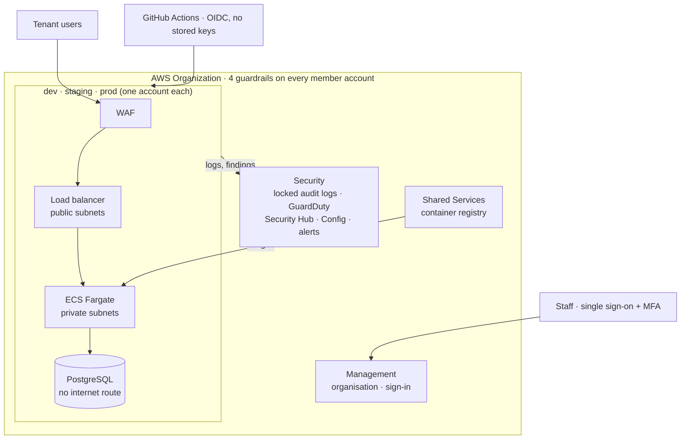

# Cobble AWS Platform

[](https://github.com/G-0Z/IFB398---Cobble-AWS---T235/actions/workflows/ci.yml)
[](https://github.com/G-0Z/IFB398---Cobble-AWS---T235/actions/workflows/drift.yml)


A secure, multi-account AWS foundation for **Cobble**, the Cyber Security
Centre's multi-tenant platform for hosting software modules for many
customer organisations at once. Everything is written in Terraform, so the
whole platform can be deployed, torn down and rebuilt identically.

**IFB398 Capstone · Team T235 · QUT, Semester 2 2026** · Industry partner:
Cyber Security Centre

> [!NOTE]
> This repository builds the platform *underneath* Cobble: accounts,
> network, sign-in, logging, monitoring, backups and security controls. The
> Cobble application itself is out of scope. Wherever a running app is
> needed to prove the platform works, a stock nginx container stands in.

## New here? Start with the handbook

The [**engineering handbook**](docs/handbook/README.md) explains the
platform to someone who has never seen it, in five pages:

| | |
|---|---|
| [Architecture](docs/handbook/architecture.md) | Accounts, guardrails, network, the path of a request, identity, logging, backups, and the decisions behind them |
| [Infrastructure code](docs/handbook/infrastructure-code.md) | How the Terraform is organised, where settings and state live, what CI checks |
| [Operations](docs/handbook/operations.md) | Deploying, demoing, releasing, monitoring, patching, backups, incidents, cost, teardown |
| [Security](docs/handbook/security.md) | Controls, threat model, scan findings, compliance posture, known gaps |
| [Deliverables](docs/handbook/deliverables.md) | What the brief asked for, what was delivered, and what's next |

## Architecture



Each environment is its own AWS account. Only the load balancer faces the
internet; the web servers sit in private subnets and the database in a
third layer with no route out. Every account's audit trail and security
findings flow to a separate Security account, where they can't be deleted.
[Full architecture →](docs/handbook/architecture.md)

## Two solutions, one codebase

Both are built from the same Terraform modules, so Solution B is a working
slice of Solution A rather than a separate prototype.

| | **Solution B** · minimum viable platform | **Solution A** · full landing zone |
|---|---|---|
| In one line | The smallest secure version, in one account | The design we'd recommend for production |
| AWS accounts | 1 | 6: management, security, shared services, dev, staging, prod |
| Builds | Encryption key, audit trail, threat detection, private network with flow logs, hardened bucket, GitHub roles, budget alert | All of B, plus guardrails, single sign-on, tamper-proof central logs, organisation-wide detection, and per environment: web servers behind a load balancer and web firewall, a private database, auto scaling |
| Deploys | 48 resources, ~5 minutes | Landing zone + dev: 143 resources, ~15 minutes |
| Cost (AUD) | ~A$0 (deployed for demos) | Demo ~A$0.35/hour · everything running ~A$790/month |
| Code | [`infrastructure/solution-b/`](infrastructure/solution-b/) | [`infrastructure/solution-a/`](infrastructure/solution-a/) |

### What Solution B leaves out, and how Solution A fills the gap

Each simplification in B is deliberate, to keep its cost near zero.

| Solution B simplifies... | Solution A instead has... |
|---|---|
| Everything in one account | Six accounts, so a mistake in dev can't reach prod |
| Audit logs deleted when it's torn down | Audit logs in a separate account, locked against deletion |
| No outbound internet from the private network | A NAT gateway for outbound traffic (one per zone in prod) |
| One encryption key for everything | A separate key in each account |
| Team members sign in as IAM users | Single sign-on through IAM Identity Center |
| Automatic checks, but deploys are run by hand | Read-only roles for checks, and deploys that need a reviewer's approval |

## Quickstart

You need [Terraform](https://developer.hashicorp.com/terraform/install)
1.10+, the [AWS CLI](https://aws.amazon.com/cli/), and an SSO sign-in to the
team's AWS organisation. [runbooks/](runbooks/README.md) has every step.

**Solution A, the landing zone with a dev environment** (the demo we show):

```powershell
aws sso login --profile AdministratorAccess-669591255093
cd infrastructure/solution-a
.\lz-dev.ps1 up       # ~15 min: security services + dev, into the existing accounts
.\lz-dev.ps1 status   # what's running, per account
.\lz-dev.ps1 down     # ~10 min: back to A$0/hour. Accounts and guardrails stay
```

**Solution B:**

```powershell
cd infrastructure/solution-b
terraform init
terraform apply
terraform destroy     # when you're done
```

Running the same commands again rebuilds exactly the same thing.

## What's proven

| | |
|---|---|
| Solution A landing zone + dev | Built and torn down with one command each way, four times (18–19 Oct 2026). Up in 13 minutes, down in 10. Re-running `up` while up reports 0 changes. [Logs](infrastructure/solution-a/evidence/) |
| Solution B | 48 resources deployed and torn down |
| Every change | Formatted, validated, tested against a mocked AWS and security-scanned by Trivy before merge ([`ci.yml`](.github/workflows/ci.yml)) |
| Deployed environments | Checked nightly for drift from the code ([`drift.yml`](.github/workflows/drift.yml)) |

Screenshots, logs and the Implementation Guide acceptance checklist are in
[Evidence](docs/Evidence/README.md). The three largest open risks (tenant
isolation, a broad admin role, backups in the same account as the data) and
their fixes are in [Security](docs/handbook/security.md#what-would-reduce-the-high-risks).

## Repository layout

```
.
├── infrastructure/          Terraform
│   ├── bootstrap/               state bucket (set up once)
│   ├── solution-b/              Solution B
│   ├── solution-a/
│   │   ├── lz-dev.ps1           one-command landing zone demo
│   │   ├── workload/            one environment; demo / dev / staging / prod.tfvars
│   │   └── landing-zone/        identity → 1-organization → 2-security → 3-shared-services
│   └── modules/                 9 tested building blocks shared by both solutions
├── runbooks/                Step-by-step deploy, demo and teardown instructions
├── docs/
│   ├── handbook/                Engineering handbook: start here
│   ├── 01-…07-*/                Capstone deliverables 1–7
│   ├── Evidence/                Deliverable 4: proof it works
│   ├── Presentation/            Deliverable 8: deck and script
│   └── Meeting Minutes/, Sprint Plans/   project records
└── .github/workflows/       CI on every change; nightly drift check
```

## Documentation

| I want to... | Go to |
|---|---|
| Understand the platform from scratch | [Engineering handbook](docs/handbook/README.md) |
| Read a capstone deliverable | [docs/](docs/README.md) |
| Deploy, demo or tear down | [runbooks/](runbooks/README.md) |
| See what the code builds, file by file | [infrastructure/](infrastructure/README.md) |
| See proof it works | [Evidence](docs/Evidence/README.md) |
| See how feedback shaped the design | [Design iterations](docs/design-iterations.md) |
| See the plan for Phase 2 | [Phase 2 roadmap](docs/phase-2-roadmap.md) |
| Look up a term | [Glossary](docs/glossary.md) |
| Contribute a change | [CONTRIBUTING.md](CONTRIBUTING.md) |

## Team

| Member | Role | Led |
|---|---|---|
| Khai Do | Operations lead | Deployment, monitoring, backup and the support model |
| Max Gosling | Project manager, build lead | Terraform, the demo, the sprint plan and the issues register |
| Jacob Hardcastle | Definition lead | The brief, requirements, scope and client meetings |
| Timothy Hartmann | Design lead | Landing zone, security controls and the risk register |

Industry partner contact: Wayne, Cyber Security Centre. How the team
planned and worked is in the [sprint reports](docs/Sprint%20Plans/README.md)
and [meeting minutes](docs/Meeting%20Minutes/README.md).

## Status

Phase 1 is in its final sprint (26 October to 8 November 2026). Both
solutions deploy, tear down and redeploy in AWS, and nothing is currently
left running. Phase 2 (Semester 1 2027) starts with the Centre choosing how
to run the platform; the options and sprint plan are in the
[Phase 2 roadmap](docs/phase-2-roadmap.md).
