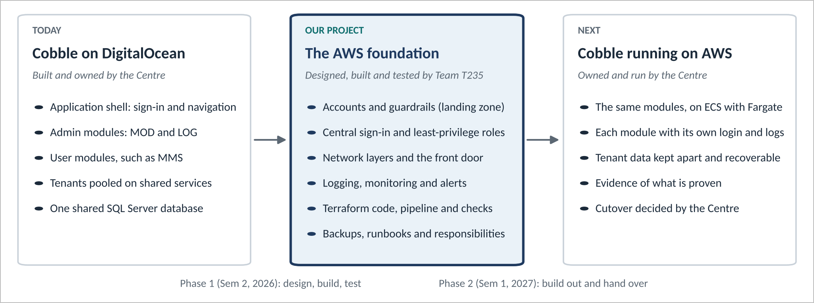
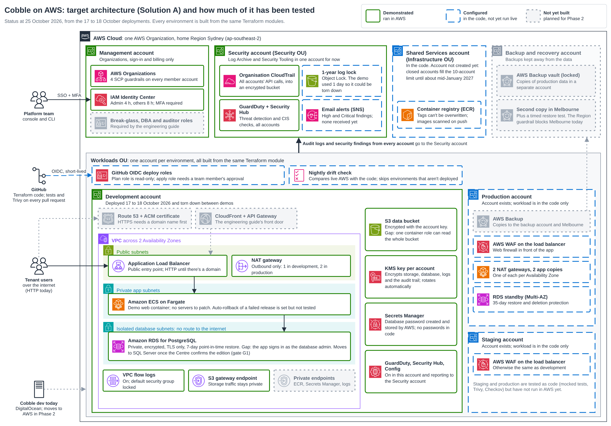
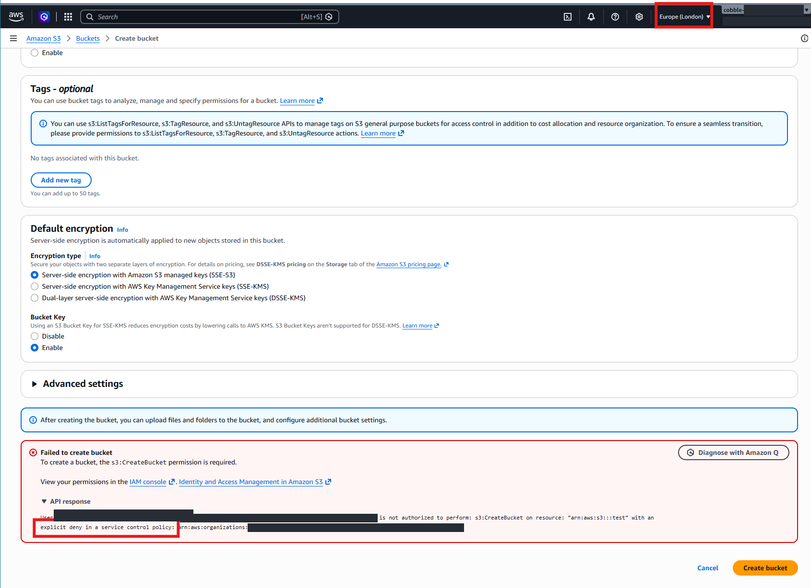
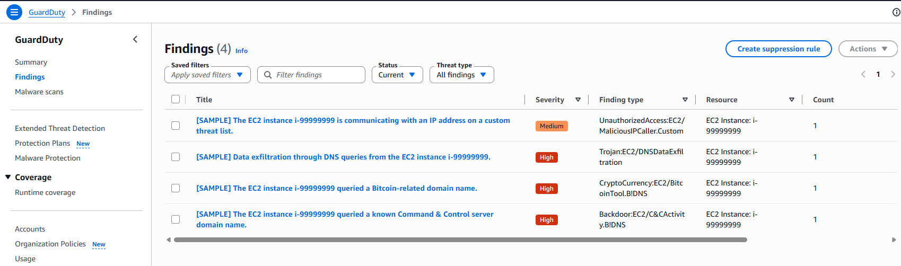

# Cobble AWS Platform: a secure, multi-account foundation built from code

[](https://github.com/G-0Z/IFB398---Cobble-AWS---T235/actions/workflows/ci.yml)
[](https://github.com/G-0Z/IFB398---Cobble-AWS---T235/actions/workflows/drift.yml)


**Team T235 | QUT IFB398 IT Capstone, Phase 1 (2026 Semester 2) |
Industry partner: Cyber Security Centre**

**Cobble** is the Cyber Security Centre's platform for hosting software
modules for many customer organisations at once. This project builds the AWS
platform underneath it (accounts, network, sign-in, logging, monitoring,
backups and security controls) in Terraform, and tests it. It works in three
steps:

1. **Build** the platform from code, so it can be deployed, torn down and
   rebuilt identically.
2. **Test** it in AWS: deploy and tear down, scan every change, check for
   drift, and try to break the guardrails.
3. **Propose** to the Centre what it's ready for, such as holding tenant
   data or a first Cobble module being built on it, and what has to happen
   first.

No real tenant data and no Cobble modules are involved. Where a running app
is needed, a stock nginx container stands in.



*Where the project sits. Cobble's code stays with the Centre. Our work is the middle box: a tested AWS foundation that the Centre will own and run after Phase 2.*

<p align="center">

<br><em>The target architecture. Green has run in AWS, blue is in the code but not yet run live, and grey isn't built yet.</em>
</p>

## Contents

- [For assessors: where to find the evidence](#for-assessors-where-to-find-the-evidence)
- [Documentation](#documentation)
- [Two solutions, one codebase](#two-solutions-one-codebase)
- [Quickstart](#quickstart)
- [Where it stands](#where-it-stands-end-of-phase-1)
- [Repository](#repository)
- [Contributing](#contributing)
- [Team T235](#team-t235)

## For assessors: where to find the evidence

| Report section | Evidence |
|---|---|
| **Definition** | [Project definition](docs/project/definition.md) · [the brief and each deliverable](docs/handbook/deliverables.md) · [governance, risks and ethics, with the risk register](docs/project/governance-risks-ethics.md) |
| **Planning** | [Phase 1 sprint record](docs/project/phase-1-sprints.md) · [Phase 2 plan](docs/project/phase-2-plan.md) · [decision records](docs/decisions/README.md) · [project board](https://github.com/users/G-0Z/projects/2) |
| **Outputs** | [The eight deliverables](docs/README.md#the-eight-deliverables) · [Terraform](infrastructure/README.md) · [runbooks](runbooks/README.md) · [engineering handbook](docs/handbook/README.md) · [Terraform standards](docs/standards/README.md) |
| **Operation** | [How we work](docs/project/way-of-working.md) · [meetings](docs/project/phase-1-meetings.md) · [design iterations](docs/project/design-iterations.md) · [contributing](CONTRIBUTING.md) · [changelog](CHANGELOG.md) |
| **Tests and proof** | [Evidence log, screenshots and checklists](docs/deliverables/evidence.md) · [deployment logs](infrastructure/solution-a/evidence/) · [CI workflows](.github/workflows/README.md) |

[↑ Contents](#contents)

## Documentation

| | Read it to... |
|---|---|
| [**Engineering handbook**](docs/handbook/README.md) | Understand the platform from scratch: [architecture](docs/handbook/architecture.md), [infrastructure code](docs/handbook/infrastructure-code.md), [operations](docs/handbook/operations.md), [security](docs/handbook/security.md), [deliverables](docs/handbook/deliverables.md) |
| [**Terraform standards**](docs/standards/README.md) | Change the code the same way it was built: [directory structure](docs/standards/directory-structure.md), [file layout](docs/standards/file-layout.md), [naming](docs/standards/naming.md), [state](docs/standards/state.md), [modules](docs/standards/modules.md), [variables and outputs](docs/standards/variables-and-outputs.md), [version control](docs/standards/version-control.md), [documentation](docs/standards/documentation.md), [testing and validation](docs/standards/testing-and-validation.md) |
| [**Runbooks**](runbooks/README.md) | Deploy, demo or tear down, step by step |
| [**Module READMEs**](infrastructure/modules/README.md) | Use a building block: plain-English summary, real usage, generated inputs and outputs |
| [**CI workflows**](.github/workflows/README.md) | See what every check does, and fix a failing one |
| [**Project docs**](docs/README.md) | Find a deliverable, the plans, meetings or decisions |

[↑ Contents](#contents)

## Two solutions, one codebase

Both are built from the same Terraform modules, so Solution B is a working
slice of Solution A ([ADR 0003](docs/decisions/0003-two-solutions-mvp-and-full-landing-zone.md)).

| | **Solution B** · minimum viable platform | **Solution A** · full landing zone |
|---|---|---|
| In one line | The smallest secure version, in one account | The full design the Implementation Guide describes |
| AWS accounts | 1 | 6: management, security, shared services, dev, staging, prod |
| Builds | Encryption key, audit trail, threat detection, private network with flow logs, hardened bucket, GitHub roles, budget alert | All of B, plus guardrails, single sign-on, tamper-proof central logs, organisation-wide detection, and per environment: web servers behind a load balancer and web firewall, a private database, auto scaling |
| Deploys | 48 resources, ~5 minutes | Landing zone + dev: 143 resources, ~15 minutes |
| Cost (AUD) | ~A$0 (deployed for demos) | Demo ~A$0.35/hour · everything running ~A$790/month |
| Code | [`infrastructure/solution-b/`](infrastructure/solution-b/) | [`infrastructure/solution-a/`](infrastructure/solution-a/) |

What B leaves out to stay near A$0, and how A fills each gap, is in
[ADR 0009](docs/decisions/0009-solution-b-shortcuts.md).

<table>
<tr>
<th width="50%">Tested: a guardrail refusing an administrator</th>
<th width="50%">Tested: a threat finding, raised and seen centrally</th>
</tr>
<tr>
<td></td>
<td></td>
</tr>
<tr>
<td>Even a full administrator can't create a bucket outside the allowed
regions: the organisation's guardrail denies it.</td>
<td>GuardDuty findings from every account land in the Security account,
where the workload teams can't delete them.</td>
</tr>
</table>

[↑ Contents](#contents)

## Quickstart

You need [Terraform](https://developer.hashicorp.com/terraform/install)
1.10+, the [AWS CLI](https://aws.amazon.com/cli/), and an SSO sign-in to the
team's AWS organisation. [runbooks/](runbooks/README.md) has every step.

```powershell
# Solution A: the landing zone with a dev environment (the demo we show)
aws sso login --profile AdministratorAccess-669591255093
cd infrastructure/solution-a
.\lz-dev.ps1 up       # ~15 min: security services + dev, into the existing accounts
.\lz-dev.ps1 status   # what's running, per account
.\lz-dev.ps1 down     # ~10 min: back to A$0/hour. Accounts and guardrails stay

# Solution B
cd infrastructure/solution-b
terraform init; terraform apply
terraform destroy     # when you're done
```

[↑ Contents](#contents)

## Where it stands (end of Phase 1)

| Step | Status |
|---|---|
| **Build** | Both solutions are in code, built from 9 shared, tested modules |
| **Test** | Solution A's landing zone and dev built and torn down four times (18–19 Oct 2026): up in 13 minutes, down in 10, and 0 changes on a re-run. Solution B: 48 resources deployed and torn down. Every change is formatted, validated, tested against a mocked AWS and scanned by Trivy. A nightly drift check is built but no environment is enrolled yet (none stays deployed); drift is caught by re-running the deployment and getting 0 changes. Staging and prod are tested in code only |
| **Propose** | The tests point to three things to fix before the platform holds tenant data or hosts a first module: tenant isolation, a broad admin role, and backups in the same account as the data ([threat model](docs/deliverables/threat-model.md#what-would-reduce-the-high-risks)). The [Phase 2 plan](docs/project/phase-2-plan.md) gives the Centre the options |

Nothing is running now: everything that costs money is torn down.

[↑ Contents](#contents)

## Repository

```
infrastructure/        Terraform: bootstrap, solution-b, solution-a, and 9 shared modules
runbooks/              step-by-step deploy, demo and teardown
docs/
  handbook/            engineering handbook: start here
  standards/           Terraform standards: the rules for changing the code
  deliverables/        the written deliverables, one page each
  project/             definition, way of working, sprints, meetings, Phase 2 plan
  decisions/           architecture decision records
  media/               diagrams and console screenshots
.github/               CI, nightly drift check, issue and PR templates
```

[↑ Contents](#contents)

## Contributing

Work on a `<Firstname>-dev` branch, run the checks, open a pull request to
`main`, and get one review. [CONTRIBUTING.md](CONTRIBUTING.md) has the commands
and the rules that matter most; the [standards](docs/standards/README.md) have the rest.

[↑ Contents](#contents)

## Team T235

| | Role | Owns |
|---|---|---|
| Max Gosling ([@G-0Z](https://github.com/G-0Z)) | Project manager, build lead | Terraform, the demo, the sprint plan and the issues register |
| Khai Do ([@tdo212](https://github.com/tdo212)) | Operations lead | Deployment, monitoring, backup and the support model |
| Jacob Hardcastle ([@JacobHardcastle](https://github.com/JacobHardcastle)) | Definition lead | The brief, requirements, scope and client meetings |
| Timothy Hartmann ([@TimHartmann98](https://github.com/TimHartmann98)) | Design lead | Landing zone, security controls and the risk register |

**Industry partner:** Wayne, Cyber Security Centre.
