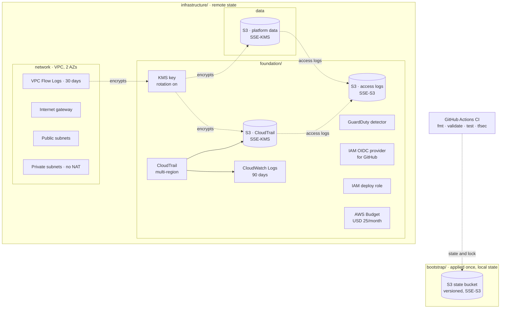

# Cobble AWS PoC

**IFB398 Capstone — P608 / R014.1** · Host organisation: QUT Client Company

A secure AWS landing zone and deployment model for **Cobble**, a proof-of-concept
multi-tenant SaaS hosting platform. This repo is the cloud engineering side —
network, identity, logging, and a working Terraform prototype that deploys it
all repeatably — not the Cobble application itself.

## Architecture

Two Terraform configs. `bootstrap/` creates the state bucket once, with local
state. `infrastructure/` is everything else, and stores its state in that
bucket — which is why tearing down the PoC never deletes the thing Terraform
needs to remember what it built.



Solid arrows: data/log flow. Dotted arrows: encryption, state, or trust. Cylinders: S3 buckets.

| Module | Creates |
|---|---|
| `bootstrap/` | The Terraform state bucket |
| `foundation/logging` | KMS key, CloudTrail, access-log bucket, GuardDuty |
| `foundation/oidc-deploy-role` | GitHub OIDC provider + deploy role (not wired into CI yet) |
| `foundation/budget` | Monthly cost budget with 80%/100% alerts |
| `network` | VPC, public/private subnets, flow logs |
| `data` | Encrypted platform data bucket |

## Repository structure

```
docs/            Capstone deliverables 1, 2, 3, 5, 6, 7, 8 (mostly scaffolding)
infrastructure/  Deliverable 4 — the Terraform PoC (each module below has its own README)
runbooks/        Operational runbooks
```

## Run it

**Prerequisites:** [Terraform](https://developer.hashicorp.com/terraform/install) >= 1.10, the [AWS CLI](https://aws.amazon.com/cli/), and an IAM user's access key (never root) with rights to create the resources above.

```powershell
git clone https://github.com/G-0Z/IFB398---Cobble-AWS---T235.git
cd IFB398---Cobble-AWS---T235

aws configure   # your IAM access key, region ap-southeast-2
aws sts get-caller-identity   # confirms credentials are live
```

**1. Bootstrap the state bucket** (first time per AWS account only — see `infrastructure/bootstrap/README.md`)

```powershell
cd infrastructure/bootstrap
terraform init
terraform apply
```

**2. Deploy everything else**

```powershell
cd ..
terraform init
terraform plan -out deploy.tfplan   # read it before applying
terraform apply deploy.tfplan
```

**3. Tear it down** (run locally, not from CI — the deploy role would delete itself mid-run)

```powershell
terraform plan -destroy -out destroy.tfplan
terraform apply destroy.tfplan
```

Everything goes except the state bucket (owned by `bootstrap/`, not this config)
and the KMS key (AWS holds it for 7 days before deleting).

**4. Redeploy — prove it's repeatable**

```powershell
terraform plan -out deploy.tfplan   # same resource count as step 2
terraform apply deploy.tfplan
terraform plan -detailed-exitcode   # exit code 0 = no drift
```

## Known simplifications (PoC scope, documented not accidental)

- Single AWS account, single region — target design uses per-environment accounts.
- No NAT gateway; private subnets have no internet egress.
- One shared KMS key for CloudTrail, flow logs, and the data bucket.
- `force_destroy = true` on PoC buckets so `terraform destroy` works cleanly.

Full reasoning is in the inline comments throughout `infrastructure/`.

## Status

🚧 In progress — the Terraform PoC (deliverable 4) deploys to a shared AWS
account with automated tests and CI. Other deliverables (`docs/01`–`08`) are
still scaffolding.

**Team:** IFB398 — Tutorial group T235
