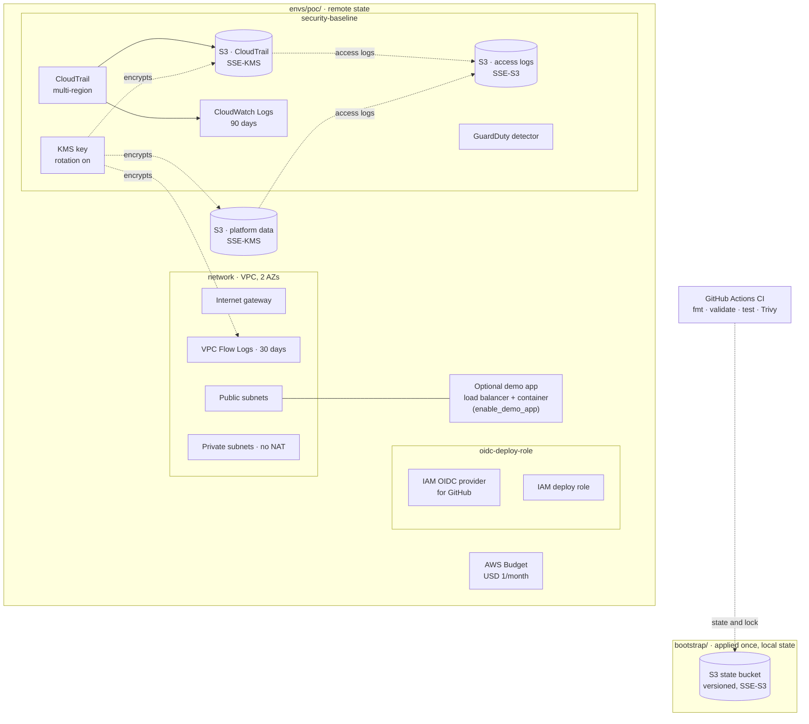

# Cobble AWS Platform

**IFB398 Capstone · P608 / R014.1 · Tutorial group T235** · Industry partner: Cyber Security Centre

A secure AWS foundation (a "landing zone") for **Cobble**, the Cyber Security
Centre's proof-of-concept multi-tenant SaaS platform. This repo is the cloud
engineering side: accounts, network, identity, logging and security, all
written as Terraform code so it can be deployed and rebuilt the same way
every time. The Cobble application itself is out of scope.

## Start here: two solutions

The project delivers the same platform at two levels of completeness.

| | **Solution B: Minimum viable product** | **Solution A: Full landing zone** |
|---|---|---|
| In one line | The smallest version that proves the design works | The complete production design |
| Where | [`infrastructure/envs/poc/`](infrastructure/envs/poc/) | [`infrastructure/solution-a/`](infrastructure/solution-a/) |
| AWS accounts | 1 | 6 (management, security, shared services, dev, staging, prod) |
| Runs an app | Optional demo page (`enable_demo_app`) | Yes: containers, load balancer, database in every environment |
| Security | KMS encryption, CloudTrail, GuardDuty, flow logs, budget alerts | Everything in B, plus guardrail policies (SCPs), single sign-on, Security Hub, AWS Config, tamper-proof audit logs, WAF, alerts |
| Cost | Near zero (deployed only for demos) | Roughly US$550 a month with everything running; see the [cost estimate](infrastructure/README.md#what-it-costs) |
| Status | Deployed and tested | Written, validated and tested; not yet deployed |
| Timeframe | Ready now (this semester) | About 3 months to roll out fully (next semester) |

**Why two?** Solution B can be shown working today for almost nothing.
Solution A is what the Cyber Security Centre would actually run. Both are
built from the same modules, so B is a working slice of A, not a separate
prototype. The decision is recorded in
[ADR 0003](docs/02-landing-zone-design/adr/0003-two-solutions-mvp-and-full-landing-zone.md).

## Find your way around

| I want to... | Go to |
|---|---|
| Understand what gets built and why | [`infrastructure/README.md`](infrastructure/README.md) |
| Deploy or tear down Solution B | [`runbooks/deploy.md`](runbooks/deploy.md), [`runbooks/teardown.md`](runbooks/teardown.md) |
| Deploy Solution A | [`runbooks/deploy-solution-a.md`](runbooks/deploy-solution-a.md) |
| See what one building block does | Each folder in [`infrastructure/modules/`](infrastructure/modules/) has a README |
| Understand what a name means, or name something new | [`docs/naming-conventions.md`](docs/naming-conventions.md) |
| Read the design decisions | [`docs/02-landing-zone-design/adr/`](docs/02-landing-zone-design/adr/) |
| Find a capstone deliverable | [`docs/README.md`](docs/README.md) |

## Repository layout

```
.
├── docs/                   Capstone deliverables 1-8, design decisions (ADRs), naming conventions
├── infrastructure/         Deliverable 4: the Terraform code
│   ├── bootstrap/          Terraform state bucket (run once per organisation)
│   ├── envs/poc/           SOLUTION B: the single-account MVP
│   ├── solution-a/         SOLUTION A: the full landing zone, in numbered steps
│   │   ├── 1-organization/     accounts, guardrails, single sign-on
│   │   ├── 2-security/         audit logs, threat detection, alerts
│   │   ├── 3-shared-services/  container image registry
│   │   └── 4-workloads/        dev, staging, prod
│   └── modules/            Building blocks shared by both solutions
├── runbooks/               Step-by-step deploy and teardown instructions
└── .github/                CI: format, validate, tests, security scan
```

## Solution B architecture

Two Terraform root configs. `bootstrap/` creates the state bucket once, with
local state. `envs/poc/` deploys everything else and keeps its state in that
bucket, so tearing down the PoC never deletes the record of what was built.



Solid arrows: data/log flow. Dotted arrows: encryption, state, or trust. Cylinders: S3 buckets.
The budget and the platform data bucket are declared directly in
[`envs/poc/main.tf`](infrastructure/envs/poc/main.tf). For where each concept
lives and the status of every security control, see
[infrastructure/README.md](infrastructure/README.md).
Solution A's architecture is in [`infrastructure/solution-a/README.md`](infrastructure/solution-a/README.md).

## Quick start (Solution B)

```powershell
git clone https://github.com/G-0Z/IFB398---Cobble-AWS---T235.git
cd IFB398---Cobble-AWS---T235
```

| Step | Runbook |
|---|---|
| 1. Create the state bucket (first time per account only) | [runbooks/bootstrap.md](runbooks/bootstrap.md) |
| 2. Deploy | [runbooks/deploy.md](runbooks/deploy.md) |
| 3. Tear down or prove repeatability | [runbooks/teardown.md](runbooks/teardown.md) |

## Known simplifications in Solution B

These are deliberate MVP scope decisions, not oversights. Solution A fixes
each one.

| Simplification in B | How Solution A handles it |
|---|---|
| Single AWS account, single region | Six accounts in an AWS Organization; other regions blocked by SCP |
| Deployed only around demos, budget alerts over USD 1/month | Long-lived environments, a budget per account |
| Teardown also removes CloudTrail and GuardDuty | Organisation-wide CloudTrail and GuardDuty live in the Security account; environments can be torn down without touching them |
| No NAT gateway, so private subnets have no internet access | NAT gateway per environment (one per AZ in prod) |
| One shared KMS key for logs and data | A separate key per account |
| `force_destroy = true` on buckets | Production buckets refuse deletion (`protect_from_deletion`) |
| Team access through IAM users with MFA | IAM Identity Center groups and permission sets; no IAM users |
| CI checks every change but doesn't deploy | Plan role for pull requests, apply role behind GitHub environment approval |

Each B simplification, with what would trigger fixing it, is recorded in
[ADR 0001](docs/02-landing-zone-design/adr/0001-deferred-landing-zone-design.md).

## Status

🚧 In progress. Solution B deploys to a shared AWS account with automated
tests and CI. Solution A is complete as code and passes the same checks, but
hasn't been deployed: it needs the client's AWS organisation. Other
deliverables are tracked in [docs/README.md](docs/README.md).
