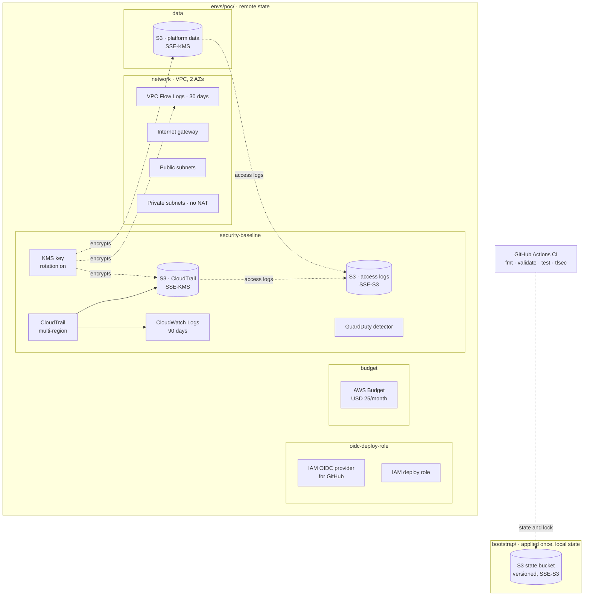

# Cobble AWS PoC

**IFB398 Capstone · P608 / R014.1 · Tutorial group T235** · Host organisation: QUT Client Company

A secure AWS landing zone and deployment model for **Cobble**, a proof-of-concept
multi-tenant SaaS hosting platform. This repo covers the cloud engineering side
(network, identity, logging, and a Terraform prototype that deploys it all
repeatably), not the Cobble application itself.

## Repository layout

```
.
├── docs/             Capstone deliverables 1-8 (index in docs/README.md)
├── infrastructure/   Deliverable 4: the Terraform PoC
│   ├── bootstrap/    State bucket, applied once
│   ├── envs/poc/     The deployable environment
│   └── modules/      security-baseline, oidc-deploy-role, budget, network, data
├── runbooks/         Step-by-step bootstrap, deploy and teardown
└── .github/          CI: fmt, validate, tests, tfsec
```

## Architecture

Two Terraform root configs. `bootstrap/` creates the state bucket once, with
local state. `envs/poc/` deploys everything else and keeps its state in that
bucket, so tearing down the PoC never deletes the record of what was built.



Solid arrows: data/log flow. Dotted arrows: encryption, state, or trust. Cylinders: S3 buckets.

| Module | Creates |
|---|---|
| [`security-baseline`](infrastructure/modules/security-baseline/) | KMS key, CloudTrail, access-log bucket, GuardDuty |
| [`oidc-deploy-role`](infrastructure/modules/oidc-deploy-role/) | GitHub OIDC provider and deploy role (not wired into CI yet) |
| [`budget`](infrastructure/modules/budget/) | Monthly cost budget with 80% and 100% alerts |
| [`network`](infrastructure/modules/network/) | VPC, public and private subnets, flow logs |
| [`data`](infrastructure/modules/data/) | Encrypted platform data bucket |

## Quick start

```powershell
git clone https://github.com/G-0Z/IFB398---Cobble-AWS---T235.git
cd IFB398---Cobble-AWS---T235
```

| Step | Runbook |
|---|---|
| 1. Create the state bucket (first time per account only) | [runbooks/bootstrap.md](runbooks/bootstrap.md) |
| 2. Deploy | [runbooks/deploy.md](runbooks/deploy.md) |
| 3. Tear down or prove repeatability | [runbooks/teardown.md](runbooks/teardown.md) |

## Known simplifications

These are deliberate PoC scope decisions, not oversights.

- Single AWS account, single region. The target design uses per-environment accounts.
- No NAT gateway, so private subnets have no internet egress.
- One shared KMS key for CloudTrail, flow logs and the data bucket.
- `force_destroy = true` on PoC buckets so teardown works cleanly.

Full reasoning is in the inline comments throughout `infrastructure/`.

## Status

🚧 In progress. The Terraform PoC deploys to a shared AWS account with
automated tests and CI. The other deliverables are still scaffolding; see
[docs/README.md](docs/README.md).
