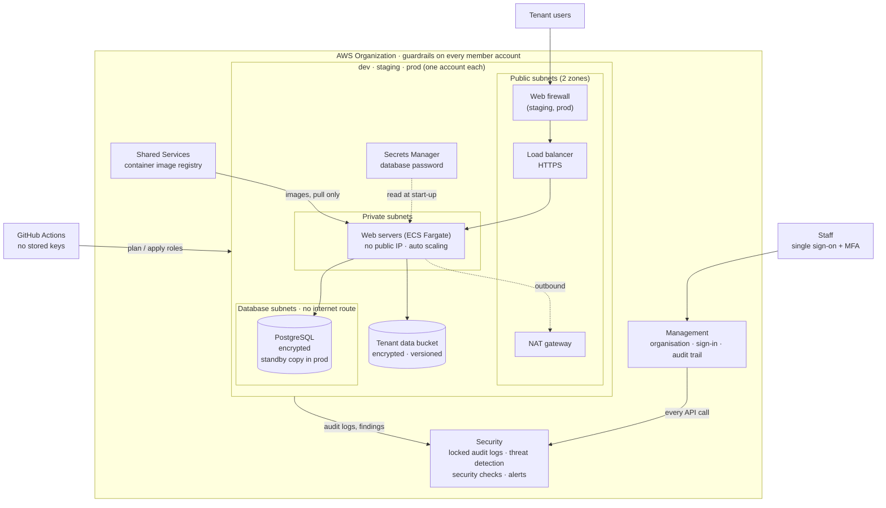

# Deliverable 1: AWS reference architecture

How Cobble is hosted in AWS: the environments, network, servers, data,
sign-in, logging, monitoring, backups and security boundaries.

**In short:** each environment (dev, staging, prod) gets its own AWS account.
Inside each one, the only thing facing the internet is a load balancer. The
web servers sit in a private network behind it, and the database sits in a
third network with no route to the internet at all. Security logs from
every account flow into a separate Security account, where they can't be
deleted.

This page describes **Solution A**, the full design. Solution B is the same
idea squeezed into one account ([Solution B](../../infrastructure/solution-b/README.md)).
Everything here is built by the code in [`infrastructure/`](../../infrastructure/),
and each section links to it.

## The whole platform

## Environments

All environments are built by the same code
([`solution-a/workload`](../../infrastructure/solution-a/workload/)). Only
their settings differ, and each environment's settings fit in one file.

| Environment | Where | Network range | Size | Safeguards |
|---|---|---|---|---|
| demo | Solution B's account, for a few hours | 10.28.0.0/16 | 1–2 small web servers, smallest database | Torn down after every demo |
| dev | `cobble-dev` account | 10.28.0.0/16 | 1 small web server, smallest database | Can be torn down nightly |
| staging (also "test") | `cobble-staging` account | 10.29.0.0/16 | As dev, plus the web firewall | Synthetic data only |
| prod | `cobble-prod` account | 10.30.0.0/16 | 2–10 web servers, larger database with a standby copy in a second zone | Deletion protection, 35 days of backups, 90 days of logs |

## Network zones

Each environment's network has three layers. Each layer only accepts
traffic from the one in front of it.

| Layer | Holds | Can reach | Can be reached from |
|---|---|---|---|
| Public | Load balancer, NAT gateway | The private layer, on the app's port only | The internet (HTTPS, through the web firewall in staging and prod) |
| Private | Web servers | The database; AWS services; the internet for outbound calls only | The load balancer only |
| Database | PostgreSQL | Nothing: no route to the internet | The web servers only |

All network traffic is logged (VPC Flow Logs), and the network's default
firewall rule is locked down so nothing gets in by accident
([`modules/network`](../../infrastructure/modules/network/)).

## Components

| Concern | What we use | Code |
|---|---|---|
| Running the application | ECS on Fargate: containers with no servers to patch. A failed release rolls itself back | [`container-service`](../../infrastructure/modules/container-service/) |
| Database | RDS for PostgreSQL. AWS manages the password in Secrets Manager | [`postgres-database`](../../infrastructure/modules/postgres-database/) |
| File storage | S3: encrypted, versioned, never public, every access logged | [`s3-bucket`](../../infrastructure/modules/s3-bucket/) |
| Application images | A container registry in Shared Services: images can't be overwritten and are scanned when pushed | [`3-shared-services`](../../infrastructure/solution-a/landing-zone/3-shared-services/) |
| Front door | A load balancer with a web firewall ([why not CloudFront and API Gateway](../02-landing-zone-design/README.md#key-decisions)) | [`load-balancer.tf`](../../infrastructure/modules/container-service/load-balancer.tf), [`waf.tf`](../../infrastructure/modules/container-service/waf.tf) |
| Sign-in | Single sign-on for people; short-lived GitHub roles for automation | [Landing zone design](../02-landing-zone-design/README.md#who-can-do-what) |
| Encryption | A separate encryption key in each account, rotated automatically | [`workload/kms.tf`](../../infrastructure/solution-a/workload/kms.tf) |
| Logging | Every AWS action recorded into a locked bucket in the Security account; network, load balancer and application logs | [`2-security`](../../infrastructure/solution-a/landing-zone/2-security/) |
| Monitoring | Threat detection, best-practice checks and configuration history in every account; serious findings emailed | [`detection.tf`](../../infrastructure/solution-a/landing-zone/2-security/detection.tf), [`alerts.tf`](../../infrastructure/solution-a/landing-zone/2-security/alerts.tf) |
| Backup | Database restorable to any point in the last 7 days (35 in prod); file versioning; locked audit logs | [Operations model](../05-deployment-operations/README.md#4-backup-and-recovery) |
| Cost | A monthly budget per account, with email alerts | [`workload/main.tf`](../../infrastructure/solution-a/workload/main.tf) |

## Security boundaries

| Boundary | What protects it |
|---|---|
| Between accounts | Separate accounts, guardrails, separate encryption keys |
| Internet to platform | Web firewall, load balancer and firewall rules. Nothing else is public |
| Web servers to database | Firewall rules, a database network with no way out, encrypted connections only |
| People to AWS | Single sign-on, MFA, short admin sessions, the least access each role needs |
| Automation to AWS | GitHub can only sign in from this repository; the read-only role can't see data; deploying needs a reviewer's approval |
| Accounts to the audit trail | The trail lives in a separate account, locked, and a guardrail stops anyone turning it off |
| Tenant to tenant | The application only (see below) |

## How tenants are kept apart

Cobble is **pooled**: in each environment, every tenant shares the same web
servers, database and storage bucket. Keeping one tenant's data away from
another is the application's job. The Implementation Guide (§9–10) has it
filter every database query by the tenant in the user's signed-in token.

The infrastructure doesn't separate tenants. That makes tenant isolation the
platform's biggest remaining risk, and the
[threat model](../06-threat-model/README.md) deals with it first. Phase 2
options: a separate database user per application module, separate
permissions per module, and storage permissions per tenant.

## How we line up with the Implementation Guide

| Guide section | Status | Notes |
|---|---|---|
| §1 One service per application module | Out of scope | No application yet; one service per environment stands in |
| §2 Reference architecture | Partial | Network zones match. The front door differs ([key decisions](../02-landing-zone-design/README.md#key-decisions)) |
| §3 Landing zone | Partial | Accounts, OUs, guardrails and single sign-on built. No disaster recovery account, break-glass role or extra admin roles ([gaps](../02-landing-zone-design/README.md#gaps)) |
| §4 Network | Partial | Layers, flow logs and S3 endpoint built. No private endpoints for other AWS services or outbound filtering |
| §5 DNS, TLS, edge | Deferred | Needs a domain name first |
| §6 Container baseline | Mostly met | Not yet: non-root containers, dropped capabilities, image digest pinning |
| §7 Kubernetes (EKS) | Not used | ECS chosen instead ([key decisions](../02-landing-zone-design/README.md#key-decisions)) |
| §8 API contracts | Out of scope | Application layer |
| §9 Data | Partial | PostgreSQL instead of SQL Server for now ([key decisions](../02-landing-zone-design/README.md#key-decisions)); no AWS Backup |
| §10 Identity, secrets, encryption | Mostly met | Keys per environment, not per type of data |
| §11 Module packaging | Out of scope | Application layer |
| §12 Build and release pipeline | Partial | Checks and GitHub roles built; automatic deploys, software bills of materials and image signing are Phase 2 |
| §13 Logging and monitoring | Partial | Security monitoring built; no application alarms or vulnerability scanning of running servers |
| §14 Availability, backup, disaster recovery | Partial | Standby database and point-in-time restore built; no AWS Backup or second region |
| §15 Infrastructure as code | Met | Terraform, ordered steps, secure shared state, peer review, nightly drift check |
| §16 Acceptance checklist | Tracked | [Deliverable 4](../04-iac-evidence/README.md#implementation-guide-acceptance-checklist) |
| §17 Runbooks and ownership | Mostly met | [Operations model](../05-deployment-operations/README.md); no disaster recovery runbook |
