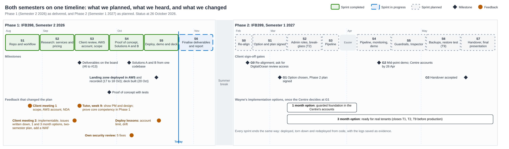

# Sprint plans and reports

Phase 1 ran as six two-week sprints, tracked on the GitHub project board
("Team Planning"). Each sprint opened with planning at the weekly team
meeting and closed with a review at the next one. The
[sprint plan](IFB398-T235-Sprint%20Plan-Phase%201%20and%202.md) covers both
semesters, including Phase 2's eight sprints and four client gates.

| Sprint | Dates (2026) | Goal | Status | Report |
|---|---|---|---|---|
| P1 S1 | 17 to 30 Aug | Repository and workflow set up | Completed | [Sprint 1](IFB398-T235-Sprint%20Report-2026-08-17-P1%20Sprint%201.md) |
| P1 S2 | 31 Aug to 13 Sep | Research: services and pricing | Completed | [Sprint 2](IFB398-T235-Sprint%20Report-2026-08-31-P1%20Sprint%202.md) |
| P1 S3 | 14 to 27 Sep | Client meeting, AWS account, deliverables scoped | Completed | [Sprint 3](IFB398-T235-Sprint%20Report-2026-09-14-P1%20Sprint%203.md) |
| P1 S4 | 28 Sep to 11 Oct | Terraform proof of concept, Solutions A and B | Completed | [Sprint 4](IFB398-T235-Sprint%20Report-2026-09-28-P1%20Sprint%204.md) |
| P1 S5 | 12 to 25 Oct | Landing zone deployed, demo and deck | Completed | [Sprint 5](IFB398-T235-Sprint%20Report-2026-10-12-P1%20Sprint%205.md) |
| P1 S6 | 26 Oct to 8 Nov | Finalise deliverables and the Phase 1 report | Current | [Sprint 6](IFB398-T235-Sprint%20Report-2026-10-26-P1%20Sprint%206.md) |

How the plan changed along the way, and why, is in
[design iterations](../design-iterations.md).
