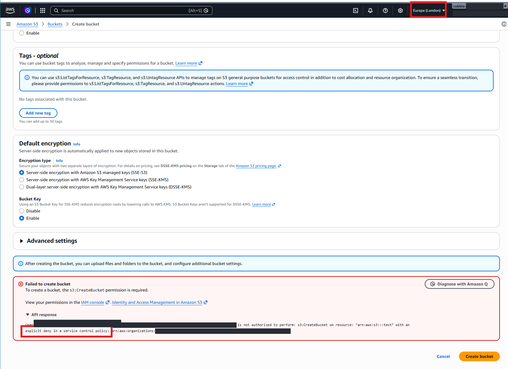
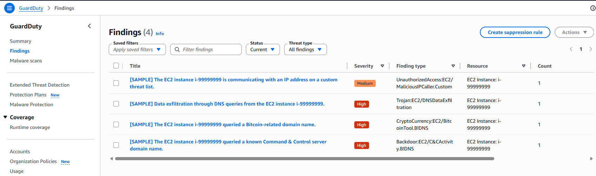
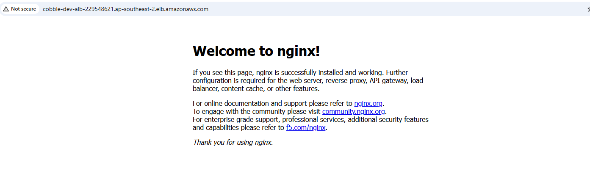

# Deliverable 4: Infrastructure-as-code prototype and evidence

The code is in [`infrastructure/`](../../infrastructure/README.md). This page
collects the **evidence that it deploys, tears down and redeploys
reliably**, and tracks the platform against the Implementation Guide's
acceptance checklist.

**In short:** both solutions deploy from code and tear down cleanly. Solution
A's landing zone with a dev environment went up and down four times on 18
and 19 October 2026 with one command each way, and the second cycle was
recorded for the demo. Deploying again gives exactly the same result, and a
final check confirms nothing differs from the code. Every change is also
checked automatically, and reviewed before it merges.

## What the prototype is

| | Solution B (MVP) | Solution A (full landing zone) |
|---|---|---|
| Code | [`solution-b`](../../infrastructure/solution-b/) | [`solution-a/`](../../infrastructure/solution-a/) |
| Deploys | 48 resources, one `terraform apply` | Landing zone + dev: `.\lz-dev.ps1 up` adds 68 security and 75 dev resources to the existing accounts. Workload alone: 66 resources in one account with `demo.tfvars` ([`workload/`](../../infrastructure/solution-a/workload/)) |
| Checked on every pull request | Formatting, validation, security scan, and automated tests for every building block | Same |
| How to run it | [runbooks/deploy-solution-b.md](../../runbooks/deploy-solution-b.md) | [Landing zone quickstart](../../runbooks/demo-landing-zone-quickstart.md) (the demo we show), or [demo-solution-a.md](../../runbooks/demo-solution-a.md) for the workload alone |

## Evidence log

Record each run here, newest first. Before committing screenshots or logs,
hide account IDs, email addresses and resource IDs (ARNs). Ideally the
person running it didn't write the code, and follows only the runbooks: that
proves the instructions work too.

| Date | What | Who | Result | Evidence |
|---|---|---|---|---|
| 2026-10-19 | Solution A landing zone + dev, two more cycles with `lz-dev.ps1` | Max Gosling | Both `up` runs: people and organisation 0 changes, security 68 added, dev 75 added. First `down`: 75 and 68 destroyed. Second `down` stopped on a timeout deleting dev's account-wide S3 public access block; re-running `down` finished it (dev 0 left, security 68 destroyed) | [up 1](../../infrastructure/solution-a/evidence/lz-dev-up-20261019-1528.txt), [down 1](../../infrastructure/solution-a/evidence/lz-dev-down-20261019-1556.txt), [up 2](../../infrastructure/solution-a/evidence/lz-dev-up-20261019-1718.txt), [down 2](../../infrastructure/solution-a/evidence/lz-dev-down-20261019-1747.txt), [down 2 re-run](../../infrastructure/solution-a/evidence/lz-dev-down-20261019-2320.txt) |
| 2026-10-18 | Solution A landing zone + dev, second cycle: `.\lz-dev.ps1 up` → console tour → `down`. **Recorded for the demo** | Max Gosling | Up in 13 minutes: people and organisation 0 changes, security 68 added, dev 75 added, app answered 200. Down in 10 minutes: dev 75 destroyed, security 68 destroyed, every member account `False` for GuardDuty, Security Hub and Config (the management account wasn't part of the status check until 1 Nov 2026) | [up](../../infrastructure/solution-a/evidence/lz-dev-up-20261018-2147.txt), [down](../../infrastructure/solution-a/evidence/lz-dev-down-20261018-2219.txt) |
| 2026-10-18 | Solution A landing zone + dev, first cycle with `lz-dev.ps1`: up → down → up (repeatability) | Max Gosling | Up: org 27 added, security 68, dev 75. Down: 75 and 68 destroyed. Re-running `up` while it was up found two things AWS reports differently from the code: GuardDuty and Security Hub members being replaced on every apply (fixed in `2-security/detection.tf`) and the database's `rds.force_ssl` setting (fixed in `modules/postgres-database`). After the fixes `up` reports 0 changes | [up](../../infrastructure/solution-a/evidence/lz-dev-up-20261018-2029.txt), [down](../../infrastructure/solution-a/evidence/lz-dev-down-20261018-2117.txt), [later `up` runs](../../infrastructure/solution-a/evidence/) |
| 2026-10-17 | Solution A landing zone + dev: deploy → teardown, accounts closed ([runbook](../../runbooks/demo-landing-zone-dev.md)) | Max Gosling | Org 45 added; security 61 added (after retries, see logs); dev 75 added / 75 destroyed; security 10 and org 34 destroyed; 5 accounts closed | [logs](../../infrastructure/solution-a/evidence/) |
| 2026-10-17 | Solution B: deploy | Max Gosling | 48 added | [logs](../../infrastructure/solution-b/evidence/) |

**Still to record:** a full Solution B and workload-only cycle (deploy →
teardown → redeploy → `plan -detailed-exitcode` exit 0), ideally run by a
teammate following only the runbooks.

## Recordings

Two screen recordings sit in `docs/media/video/` on the team's machines.
Video files are git-ignored (`*.mp4` in `.gitignore`) because of their size,
so they aren't in the repository; share them through Canvas instead.

| File | Recorded | Shows |
|---|---|---|
| `solution-a-demo.mp4` | 18 October 2026 | The landing zone demo: the second cycle in the evidence log above |
| `solution-b-demo.mp4` | 17 October 2026 | Solution B |

## Screenshots

Taken from the landing zone demo. Account IDs, organisation IDs, email
addresses, student numbers and sign-in names are blacked out. The full list, and where each one is taken, is in the
[landing zone runbook](../../runbooks/demo-landing-zone-dev.md#6-evidence).
Click a group to open it.

<b>Sign-in and the organisation</b> (management account)

| Shows | Screenshot |
|---|---|
| The access portal, listing the accounts | [01-portal-accounts.png](../media/screenshots/01-portal-accounts.png) |
| The three `cobble-` groups and the user | [02-idc-groups.png](../media/screenshots/02-idc-groups.png), [02b-idc-users.png](../media/screenshots/02b-idc-users.png) |
| The three permission sets | [03-idc-permission-sets.png](../media/screenshots/03-idc-permission-sets.png) |
| MFA required | [04-idc-mfa.png](../media/screenshots/04-idc-mfa.png) |
| The account folders (OUs) | [05-org-tree.png](../media/screenshots/05-org-tree.png) |
| The four guardrails, attached to Root | [06-scps.png](../media/screenshots/06-scps.png), [06b-org-policy-types.png](../media/screenshots/06b-org-policy-types.png), [07-scps-root-targets.png](../media/screenshots/07-scps-root-targets.png) |
| **A guardrail refusing an administrator** | [08-scp-deny.png](../media/screenshots/08-scp-deny.png) |

<b>Central security</b> (<code>cobble-security</code>)

| Shows | Screenshot |
|---|---|
| The organisation trail | [09-cloudtrail-org-trail.png](../media/screenshots/09-cloudtrail-org-trail.png) |
| GuardDuty covering the other accounts | [11-guardduty-accounts.png](../media/screenshots/11-guardduty-accounts.png) |
| Security Hub standards, summary and members | [12-securityhub-standards.png](../media/screenshots/12-securityhub-standards.png), [12b-securityhub-summary.png](../media/screenshots/12b-securityhub-summary.png), [13-securityhub-members.png](../media/screenshots/13-securityhub-members.png) |
| Config aggregating every account | [14-config-aggregator.png](../media/screenshots/14-config-aggregator.png) |
| A sample threat finding, raised and seen centrally | [15-sample-finding.png](../media/screenshots/15-sample-finding.png), [15b-sample-finding-cli.png](../media/screenshots/15b-sample-finding-cli.png) |

<b>The dev environment</b> (<code>cobble-dev</code>)

| Shows | Screenshot |
|---|---|
| Six subnets in three layers; flow logs on | [17-vpc-subnets.png](../media/screenshots/17-vpc-subnets.png), [18-vpc-flow-logs.png](../media/screenshots/18-vpc-flow-logs.png) |
| Web servers with private IPs only; auto scaling | [19-ecs-cluster-tasks.png](../media/screenshots/19-ecs-cluster-tasks.png), [20-ecs-autoscaling.png](../media/screenshots/20-ecs-autoscaling.png) |
| Database not publicly accessible, encrypted | [21-rds-connectivity.png](../media/screenshots/21-rds-connectivity.png), [22-rds-encryption.png](../media/screenshots/22-rds-encryption.png) |
| Database password in Secrets Manager | [23-secrets-db.png](../media/screenshots/23-secrets-db.png) |
| Data bucket encrypted, versioned, never public | [24-s3-data-props.png](../media/screenshots/24-s3-data-props.png), [25-s3-data-perms.png](../media/screenshots/25-s3-data-perms.png) |
| The budget | [26-budget.png](../media/screenshots/26-budget.png) |
| The app, served through the load balancer | [27-app-url.png](../media/screenshots/27-app-url.png) |

<b>CI and teardown</b>

| Shows | Screenshot |
|---|---|
| A green CI run | [28-ci-green.png](../media/screenshots/28-ci-green.png) |
| Dev, security and organisation torn down | [31-teardown-dev.png](../media/screenshots/31-teardown-dev.png), [32-teardown-security.png](../media/screenshots/32-teardown-security.png), [33-teardown-org.png](../media/screenshots/33-teardown-org.png) |
| Accounts closed (17 October run) | [30-accounts-closed.png](../media/screenshots/30-accounts-closed.png) |

**Not captured yet:** `10-s3-object-lock.png`, `16-alert-email.png`,
`29-cost-explorer.png`.

## Implementation Guide acceptance checklist

The Guide's platform acceptance checklist (§16.1, p.31). Many items are
about the Cobble application, which is out of scope. Those are marked N/A
rather than left blank.

| # | Guide item (summarised) | Status | Evidence or reason |
|---|---|---|---|
| 1 | All production resources created by IaC; drift reports clean | Partial | Everything is Terraform; nightly drift plan ([`drift.yml`](../../.github/workflows/drift.yml)), built but no environment enrolled yet; re-running `up` reports 0 changes. No production deployed yet |
| 2 | No task, ALB backend or RDS instance publicly reachable | Met (design) | Private subnets, no public IPs, database subnets with no route ([architecture](reference-architecture.md#network-zones)). Screenshots: [ECS](../media/screenshots/19-ecs-cluster-tasks.png), [RDS](../media/screenshots/21-rds-connectivity.png) |
| 3 | WAF enforcing tuned rules, logs to the central account | Partial | Web firewall in staging and prod; not yet tuned; no firewall logging ([key decisions](landing-zone-design.md#key-decisions)) |
| 4 | Every API route follows `/apl`, `/adm`, `/aum` versioned paths | N/A | Application routes; no API Gateway yet ([key decisions](landing-zone-design.md#key-decisions)) |
| 5 | Each module API has its own task identity, secrets, DB principal, target group, log group, alarms | N/A (needs Cobble's modules) | One service per environment until the application exists; Phase 2's stand-in module shows part of it |
| 6 | Runtime DB principals can't do direct table DML or call other modules' procedures | N/A (needs Cobble's modules) | Application schema; app currently uses the master user |
| 7 | RLS negative tests prove missing tenant context fails closed | N/A | Application |
| 8 | Module install, verify, disable, re-enable, roll back, with audit records | N/A | Application |
| 9 | N, N-1 and N-2 versions coexist | N/A | Application |
| 10 | A disabled module can't receive credentials or traffic | N/A | Application |
| 11 | Blue/green rollback, RDS failover and backup restore meet RTO/RPO | Not met | Circuit breaker rollback built; failover and restore not yet tested ([ops model §4](deployment-operations.md#restore-testing)) |
| 12 | Critical ECR / Inspector findings block release; SBOM and digest kept | Not met | Scan on push only; no Inspector, SBOM or digest pinning |
| 13 | CloudTrail, Container Insights, logs, traces and findings visible to on-call | Partial | CloudTrail, findings, logs, Container Insights (prod) built; no tracing |
| 14 | Runbooks, escalation contacts, ownership and access reviews approved | Partial | Runbooks and RACI written ([ops model](deployment-operations.md)); named contacts and approval pending |

## Handoff checklist

The Guide's final handoff checklist (Appendix E, p.36), for whoever takes
the platform on next.

| Item | Status |
|---|---|
| Architecture decisions approved | Recorded in [deliverable 2](landing-zone-design.md#key-decisions); client approval pending |
| IaC repositories and deployment roles created | Done (this repo; `github-oidc` roles) |
| Diagrams updated with deployed identifiers | Pending deployment |
| Security group, route, WAF and IAM policies peer reviewed | Each change reviewed by pull request |
| Secrets, keys, rotation and break-glass tested | Not yet; no break-glass role |
| Module deployment and recovery tests | N/A (application) |
| RDS failover and restore evidence | Not yet |
| Dashboards, alarms, runbooks, on-call accepted | Runbooks written; no alarms or dashboards |
| Cost forecast, budgets, quotas approved | Cost estimate in [`infrastructure/README.md`](../../infrastructure/README.md#what-it-costs); budgets built; approval pending |
| Go-live and rollback authority named | Pending (platform product owner) |
