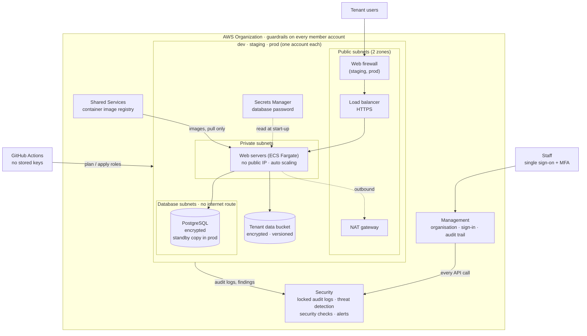
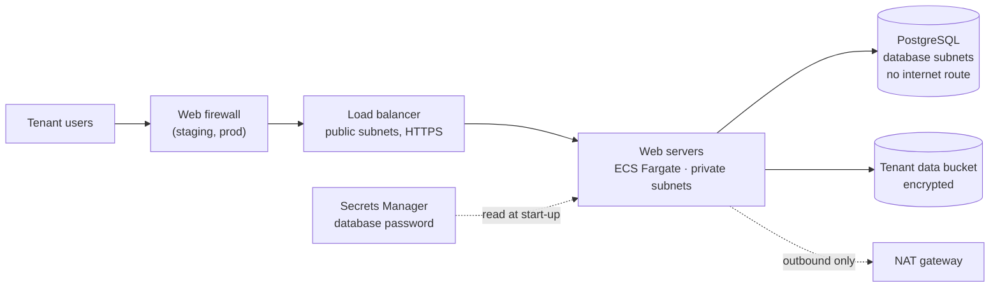

# Architecture

How the Cobble platform is shaped in AWS. This page describes Solution A,
the full design; the [last section](#solution-b-the-same-design-in-one-account)
explains how Solution B compresses it into one account. Everything here is
built by the code in [`infrastructure/`](../../infrastructure/README.md),
and each section points to the file that builds it.

## The shape of it

Each environment (dev, staging, prod) is its own AWS account. Inside an
environment, the only thing facing the internet is a load balancer. Web
servers sit in private subnets behind it, and the database sits in a third
subnet layer with no route to the internet at all. Every account sends its
audit logs and security findings to a separate Security account where they
can't be deleted. Four guardrails apply to every account, administrators
included. People sign in once through single sign-on; automation signs in
from GitHub with short-lived tokens and no stored keys.

A version of this diagram marked up to show which parts have actually run in
AWS is in
[`cobble-target-architecture.png`](../01-reference-architecture/cobble-target-architecture.png)
(editable `.drawio` alongside it).

## Accounts

The layout follows the AWS Security Reference Architecture, with one
simplification: a single Security account does the job AWS splits into "Log
Archive" and "Security Tooling", which halves the fixed cost while keeping
the same separation from the workloads.

| Organisational unit | Account | Purpose | Built by |
|---|---|---|---|
| (root) | Management | Runs the organisation, billing and single sign-on. Runs no applications, because guardrails don't apply to the management account | [`1-organization`](../../infrastructure/solution-a/landing-zone/1-organization/) |
| Security | `cobble-security` | Holds the locked audit logs; is the delegated administrator for GuardDuty, Security Hub, Config and Access Analyzer across every account; sends alerts | [`2-security`](../../infrastructure/solution-a/landing-zone/2-security/) |
| Infrastructure | `cobble-shared-services` | The container image registry every environment pulls from | [`3-shared-services`](../../infrastructure/solution-a/landing-zone/3-shared-services/) |
| Workloads / NonProduction | `cobble-dev` | Where developers try changes. Can be torn down when idle | [`workload`](../../infrastructure/solution-a/workload/) + `dev.tfvars` |
| Workloads / NonProduction | `cobble-staging` | Dress rehearsal for prod with synthetic data. Also serves as the "test" environment | `workload` + `staging.tfvars` |
| Workloads / Production | `cobble-prod` | What tenants use | `workload` + `prod.tfvars` |

Each environment has its own account, its own IP range and its own
encryption key, so nothing in one environment can reach another by
accident. Account separation is the strongest boundary AWS offers: a
mistake in dev cannot touch prod.

Note: the Shared Services account is in the code but had not been created
at the time of writing. Accounts closed during an earlier test run count
against the organisation's account quota for 90 days, until about
mid-January 2027. The Implementation Guide's separate disaster-recovery and
backup accounts are not built yet (see [gaps](security.md#known-gaps)).

## Guardrails

Guardrails are AWS Organizations service control policies (SCPs). They
apply to every member account and to everyone in it, including
administrators. Nothing in a member account can override them, which is why
the management account runs nothing.

| Guardrail | Stops anyone from... | Policy file |
|---|---|---|
| Restrict regions | Creating resources outside Sydney (`ap-southeast-2`), plus `us-east-1` for the handful of global AWS services that need it | [`restrict-regions.json.tftpl`](../../infrastructure/solution-a/landing-zone/1-organization/policies/restrict-regions.json.tftpl) |
| Deny root user | Using an account's root user at all | [`deny-root-user.json`](../../infrastructure/solution-a/landing-zone/1-organization/policies/deny-root-user.json) |
| Protect security services | Switching off, or quietly muting, the audit trail, GuardDuty, Security Hub, Config or VPC flow logs. "Quietly muting" covers things like auto-archiving findings or emptying the Config recorder, which a plain "deny delete" would miss | [`protect-security-services.json.tftpl`](../../infrastructure/solution-a/landing-zone/1-organization/policies/protect-security-services.json.tftpl) |
| Deny leaving the organisation | Removing an account from the organisation (and so escaping the other three guardrails) | [`deny-leave-organization.json`](../../infrastructure/solution-a/landing-zone/1-organization/policies/deny-leave-organization.json) |

All four are attached at the organisation root. They're written as targeted
denies, following AWS's published SCP examples.

## Who can do what

### People: IAM Identity Center

Staff sign in through IAM Identity Center (AWS single sign-on) with MFA
required. Solution A has no IAM users and no long-lived passwords or access
keys. **Groups** say who someone is; **permission sets** say what they can
do in which account. Group membership is a CSV file
([`identity/users.csv`](../../infrastructure/solution-a/landing-zone/identity/)),
so adding or removing a person is a one-line change and an apply.

| Group | Management | Security | Shared Services | dev | staging | prod |
|---|---|---|---|---|---|---|
| `cobble-platform-admins` | Admin | Admin | Admin | Admin | Admin | Admin |
| `cobble-developers` | | | | Developer | Read-only | Read-only |
| `cobble-auditors` | Read-only | Read-only | Read-only | Read-only | Read-only | Read-only |

| Permission set | Can do | Session length |
|---|---|---|
| `CobblePlatformAdmin` | Anything | 4 hours |
| `CobbleDeveloper` | Anything except managing users and permissions | 8 hours |
| `CobbleReadOnly` | Look, don't touch | 8 hours |

The assignments are in
[`identity-center.tf`](../../infrastructure/solution-a/landing-zone/1-organization/identity-center.tf).
The MFA requirement is an Identity Center console setting with no API, so
it's a documented manual step rather than code.

### Automation: GitHub OIDC

GitHub Actions gets access to each account through OpenID Connect: GitHub
presents a short-lived token, AWS checks it came from this repository, and
hands back temporary credentials for one of two roles
([`modules/github-oidc`](../../infrastructure/modules/github-oidc/)).

| Role | Who can assume it | What it can do |
|---|---|---|
| `…-terraform-plan` | Any pull request, and the nightly drift check | Read everything needed to run `terraform plan`. It is explicitly denied reading the *contents* of buckets and logs, so a pull request from any branch can never reach tenant data |
| `…-terraform-apply` | Only a workflow run in the matching GitHub environment, which needs a reviewer's approval | Make changes in that one account. The organisation's guardrails still apply |

Neither role has stored keys. Both can only touch their own environment's
Terraform state file.

## Inside one environment

### Network layers

Each environment's VPC spans two availability zones and has three subnet
layers. Each layer accepts traffic only from the layer in front of it, using
security groups that reference each other rather than IP ranges.

| Layer | Holds | Can reach | Can be reached from |
|---|---|---|---|
| Public | Load balancer, NAT gateway(s) | The private layer, on the application's port only | The internet, HTTPS only (through the web firewall in staging and prod) |
| Private | Web servers (ECS tasks, no public IP) | The database; AWS services (S3 via a gateway endpoint); the internet for outbound calls via NAT | The load balancer only |
| Database | PostgreSQL | Nothing: there is no route to the internet | The web servers only, on port 5432 |

All traffic, allowed or refused, is recorded by VPC Flow Logs into an
encrypted log group. The VPC's default security group is stripped of all
rules so nothing can be reached by accident
([`modules/network`](../../infrastructure/modules/network/)).

### The path of one request

1. A tenant's browser connects over HTTPS. In staging and prod the request
   first passes AWS WAF, which applies three AWS-managed rule groups (common
   web attacks, known bad inputs including Log4j patterns, and an IP
   reputation list) and a per-IP rate limit
   ([`waf.tf`](../../infrastructure/modules/container-service/waf.tf)).
2. The Application Load Balancer terminates TLS 1.2+ (once a certificate is
   attached; plain HTTP is used for demos without a domain), checks the
   container's health endpoint, and forwards to a healthy task
   ([`load-balancer.tf`](../../infrastructure/modules/container-service/load-balancer.tf)).
3. The task runs on ECS Fargate in a private subnet. It started with the
   database username and password injected from Secrets Manager, and holds a
   task role that allows exactly three things: list, read and write its own
   data bucket, and use the environment's KMS key
   ([`ecs.tf`](../../infrastructure/modules/container-service/ecs.tf),
   [`workload/main.tf`](../../infrastructure/solution-a/workload/main.tf)).
4. The task talks to PostgreSQL over an encrypted connection (the database
   refuses unencrypted ones) and to the data bucket through the S3 gateway
   endpoint, which never leaves the AWS network.
5. Everything along the way is logged: the load balancer's access log to an
   S3 bucket, the container's output to CloudWatch, every AWS API call to the
   organisation audit trail.

### Components

| Concern | What's used | Why | Module |
|---|---|---|---|
| Running the application | ECS on Fargate | No servers to patch, no cluster to upgrade. A release that fails its health checks rolls itself back (deployment circuit breaker). CPU-based auto scaling | [`container-service`](../../infrastructure/modules/container-service/) |
| Database | RDS for PostgreSQL | Private, encrypted, forced TLS. AWS generates the admin password and keeps it in Secrets Manager; no person ever sees it. Point-in-time restore; Multi-AZ standby in prod | [`postgres-database`](../../infrastructure/modules/postgres-database/) |
| Tenant file storage | S3 | Encrypted with the environment's key, versioned (old versions kept 90 days), never public, every access logged | [`s3-bucket`](../../infrastructure/modules/s3-bucket/) |
| Application images | ECR in Shared Services | Tags can't be overwritten, images are scanned on push, only accounts in the organisation can pull. The 30 most recent images are kept | [`3-shared-services`](../../infrastructure/solution-a/landing-zone/3-shared-services/) |
| Front door | ALB + AWS WAF | Enough protection without a domain. CloudFront and API Gateway are deferred until a domain and API routes exist | `container-service` |
| Encryption keys | One KMS key per account, rotated yearly | Encrypts the database, buckets, logs and secrets in that account | [`workload/kms.tf`](../../infrastructure/solution-a/workload/kms.tf) |
| Account safety settings | Public-bucket block, EBS encryption by default, password policy, AWS Config recorder | Set once per account, so a misconfigured resource can't become public or unencrypted | [`account-baseline`](../../infrastructure/modules/account-baseline/) |
| Access logs | A dedicated bucket per account | Collects S3 and load balancer access logs | [`access-log-bucket`](../../infrastructure/modules/access-log-bucket/) |
| Cost control | AWS Budgets per account | Email at 80% of actual spend and when the month's forecast passes 100% | `workload/main.tf` |

### Environments differ only by settings

The same `workload` code builds every environment. Only the values file
changes.

| | demo | dev | staging | prod |
|---|---|---|---|---|
| Account | The team's own (shared with Solution B), for a few hours | `cobble-dev` | `cobble-staging` | `cobble-prod` |
| IP range | 10.28.0.0/16 | 10.28.0.0/16 | 10.29.0.0/16 | 10.30.0.0/16 |
| NAT gateways | 1 | 1 | 1 | 1 per zone |
| Web servers | 1–2 small | 1 small | 1–2 small | 2–10, larger |
| Web firewall | no | no | yes | yes |
| Database | smallest, single zone | smallest, single zone | smallest, single zone | larger, Multi-AZ standby |
| Backups kept | 7 days | 7 days | 7 days | 35 days |
| Logs kept | 30 days | 30 days | 30 days | 90 days |
| Deletion protection | no | no | no | yes (database, load balancer, buckets) |
| Container Insights | no | no | no | yes |

## Central security: the Security account

The Security account is the delegated administrator for the organisation's
security services, which means the member accounts can't opt out
([`delegation.tf`](../../infrastructure/solution-a/landing-zone/2-security/delegation.tf),
[`detection.tf`](../../infrastructure/solution-a/landing-zone/2-security/detection.tf)).

| Service | What it does | Where findings go |
|---|---|---|
| CloudTrail (organisation trail) | Records every API call in every account and region, with log-file integrity validation | An S3 bucket in the Security account with **Object Lock** (governance mode, 365 days): logs can't be changed or deleted before they expire. Encrypted with the Security account's key |
| GuardDuty | Threat detection: compromised credentials, crypto-mining, unusual API activity | Security Hub, and email for high/critical |
| Security Hub | Checks every account against CIS AWS Foundations Benchmark v3.0 and AWS Foundational Security Best Practices | Central findings view; email for high/critical |
| AWS Config | Records how every resource's configuration changes over time | An aggregator in the Security account; history stored in a central bucket |
| IAM Access Analyzer | Flags anything shared outside the organisation | Security Hub |
| SNS | Email alerts for high and critical findings | The security alerts address |

The "protect security services" guardrail makes all of this *enforced*
rather than merely configured: an administrator in dev cannot switch off
GuardDuty, stop the trail, or delete the flow logs.

## Encryption and secrets

- **At rest.** Every account has its own customer-managed KMS key with
  automatic yearly rotation. It encrypts the database, the data and log
  buckets, CloudWatch log groups, flow logs and the task's secrets. New EBS
  volumes are encrypted by default account-wide.
- **In transit.** The load balancer accepts TLS 1.2 or later (with a
  certificate). The database rejects unencrypted connections
  (`rds.force_ssl`). The audit, access-log and state buckets refuse
  non-HTTPS requests; the tenant data bucket doesn't yet, which is a listed
  gap.
- **Secrets.** No password appears in code, settings files or task
  definitions. RDS generates the admin password and stores it in Secrets
  Manager; the ECS task reads it at start-up through a reference to the
  secret, encrypted with the environment's key.

## Logging and monitoring

| What | How | Retention |
|---|---|---|
| Every AWS API call | Organisation CloudTrail → locked bucket in Security | 365 days (Object Lock) |
| Network connections | VPC Flow Logs → encrypted CloudWatch log group | 30 days; 90 in prod |
| HTTP requests | ALB access logs → access-log bucket | Bucket lifecycle |
| Application output | CloudWatch log group `/cobble-<env>/app` | 30 days; 90 in prod |
| Resource configuration | AWS Config → central bucket | History |
| Container CPU and memory | ECS metrics; Container Insights in prod | CloudWatch |
| Drift from code | Nightly `terraform plan` with the read-only role | GitHub Actions run |
| Spend | AWS Budgets | Email alerts |

What's missing today: application-level alarms (5xx rate, unhealthy hosts,
database CPU/storage/connections), dashboards, WAF logs, and S3 object-level
events in CloudTrail. These are the next phase's monitoring work
([operations.md](operations.md#monitoring-and-alerting)).

## Backups and recovery

| Data | Protection | Kept |
|---|---|---|
| Database | Automated backups with point-in-time restore. In prod: Multi-AZ standby, deletion protection, final snapshot on delete | 7 days; 35 in prod |
| Tenant files | S3 versioning | Old versions 90 days |
| Audit logs | Object Lock | 365 days |
| Container images | Immutable ECR tags | 30 most recent |
| The platform itself | Terraform code in Git; state in a versioned, encrypted bucket | Git history |

The containers hold no data, so recovering one means redeploying the same
image. The largest open gap is that there is **no backup copy outside the
account or region**: losing the prod account would lose its backups too. AWS
Backup to a separate backup account and to Melbourne is the planned fix.

## Multi-tenancy: what the platform does and doesn't do

Cobble is **pooled**: in each environment every tenant shares the same web
servers, database and bucket. The infrastructure keeps *environments* apart
(accounts, networks, keys) and keeps the *outside world* out, but it does
not separate one tenant from another. That is the application's job: the
Implementation Guide has it filter every database query by the tenant in
the user's signed-in token (row-level security).

This makes tenant isolation the platform's biggest residual risk, and the
threat model treats it first. The planned next steps are a database user per
module with least privilege, a task role per module, tenant-prefixed bucket
access, and cross-tenant tests in CI.

## Solution B: the same design in one account

Solution B ([`infrastructure/solution-b/`](../../infrastructure/solution-b/))
builds the security baseline in a single account for almost no cost. Each
simplification is deliberate, and Solution A is the full answer to it.

| Solution B simplifies... | Solution A instead has... |
|---|---|
| Everything in one account | Six accounts, so a mistake in dev can't reach prod |
| Audit trail deleted when it's torn down | Audit logs in a separate account, locked against deletion |
| No NAT gateway (saves about A$62 a month), so private subnets have no outbound internet | A NAT gateway (one per zone in prod) |
| One encryption key for everything | A key per account |
| Team members sign in as IAM users with MFA | Single sign-on through Identity Center |
| No guardrails (they need an organisation) | Four SCPs no administrator can override |
| No database, optional public demo web page | A private database and private web servers in every environment |

Solution B builds: a KMS key, a CloudTrail trail with a searchable 90-day
CloudWatch copy, GuardDuty, a two-zone VPC with flow logs, an encrypted data
bucket, an access-log bucket, the two GitHub roles, and a US$1 budget alert.
Set `enable_demo_app = true` and it adds a load balancer and one small
container.

## The decisions behind the design

Each is recorded with what would make the team revisit it
([full list](../02-landing-zone-design/README.md#key-decisions)).

1. **Two solutions from one set of modules.** Two codebases would drift
   apart; one keeps Solution B an honest subset of A.
2. **Every environment from one `workload` folder plus a values file.**
   Environments can differ in size, standby database and web firewall, and
   nowhere else.
3. **ECS Fargate rather than Kubernetes (EKS).** The Implementation Guide
   recommends EKS only when the team can run Kubernetes day to day. Fargate
   has no servers or cluster upgrades to manage.
4. **One Security account rather than two.** Halves the fixed cost with the
   same separation from workloads. Revisit at production scale or if an
   auditor asks.
5. **PostgreSQL for now, not SQL Server.** The Guide specifies RDS for SQL
   Server. Licensing makes it far more expensive at small sizes, and no
   Cobble database exists yet. All the controls are built the same way, so
   swapping is a module change. The team's position is that SQL Server is
   the target and the swap happens next phase.
6. **ALB + WAF rather than CloudFront + API Gateway.** Until there's a domain
   and defined API routes, a public load balancer with a web firewall gives
   the needed protection for less cost and complexity.
7. **Solution B accepts shortcuts to stay near A$0.** Listed in the table
   above. Revisit if it's ever left running long-term.

## What has actually run

As of late October 2026 (full evidence in [`docs/Evidence/`](../Evidence/README.md)):

- **Demonstrated:** the organisation, OUs, accounts, four guardrails,
  Identity Center groups and permission sets, the Security account's trail,
  Object-Locked log bucket, GuardDuty, Security Hub, Config aggregator,
  Access Analyzer and alert topic, and the dev environment end to end
  (VPC, ECS, RDS, Secrets Manager, data bucket, budget, a 200 response from
  the app through the load balancer). Also Solution B in full.
- **Configured, not yet run live:** staging and prod, the web firewall,
  HTTPS (needs a certificate), the Shared Services registry, the GitHub
  deploy workflow, an end-to-end alert email.
- **Not yet built:** application alarms, cross-account/cross-region
  backups, narrowed admin roles and break-glass, Inspector, WAF logging,
  disaster recovery.
