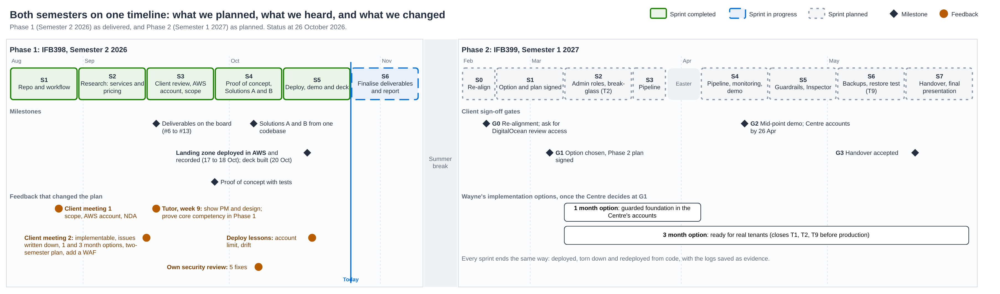

# Phase 2 roadmap: IFB399, Semester 1 2027

How Phase 2 starts, what the Cyber Security Centre decides, when they sign
off, and what we build each sprint. The sprints and issues are on the
[project board](https://github.com/users/G-0Z/projects/2).

**In short:** Phase 2 starts with the Centre's decision, not ours. Phase 1
gives them three ways to configure Cobble's platform. We put the options in
front of them in Week 0, they choose one and sign the Phase 2 plan by the end
of Week 2, and then we build. Most of the work in Weeks 3 to 11 is the same
Terraform whichever option they choose, so waiting for the decision costs no
build time.

## Why Phase 2 starts with a decision

Two things aren't settled yet, and both belong to the Centre:

1. **How they want the platform configured.** Phase 1 built and tested two
   solutions in our own AWS organisation. Which one the Centre runs, in
   whose accounts, and at what budget is their decision.
2. **Development approval to review their DigitalOcean platform.** We
   haven't been given access to review it yet. Until we have, we can't say
   how what runs there today maps onto the AWS design, or what a move would
   involve.

So the first job in Phase 2 is to re-confirm scope with the Centre, not to
write code.

## The three options

All three come from Phase 1. The Centre chooses one. If the decision isn't
made by the end of Week 2, we carry on with the work that every option needs
(Weeks 3 to 11 below) in our own organisation, so no weeks are lost.

| | Option 1: full landing zone | Option 2: start small, grow | Option 3: review DigitalOcean first |
|---|---|---|---|
| **What it is** | Solution A deployed into the Centre's own AWS organisation: six accounts, guardrails, single sign-on, central security | Solution B in one Centre account now; move to Solution A when real tenants arrive | Review the platform the Centre runs on DigitalOcean today, then choose Option 1 or 2 with that evidence |
| **Cost to run** | About A$790 a month with everything on, A$475 with dev and staging off when idle | About A$0 between demos | Our time only, until a build option is chosen |
| **The Centre provides** | An AWS organisation, a budget, their identity provider | One AWS account | Development approval and read-only access to DigitalOcean |
| **What they get** | The Implementation Guide's target design, running | The same building blocks, cheaply, with a clear upgrade path | A map of today's platform against the ten control areas, and a migration or hardening plan |
| **Main trade-off** | Highest running cost | No organisation-wide guardrails until it grows | Build work starts later |

The same Terraform modules build Options 1 and 2, so choosing one doesn't
rule out the other later.

## Implementation options: 1 month or 3 months

Wayne asked for both timeframes on 14 September. They were first set out
week by week in the Solution A and B comparison (6 October). This version
is updated for what Phase 1 has already proven in our own AWS organisation,
so it describes deploying into the **Centre's** accounts once they've chosen
Option 1 or 2.

| Option | When | What gets done | Already proven in Phase 1? |
|---|---|---|---|
| **1 month: a guarded foundation** | Week 1 | The Centre confirms accounts, budget, region and owner. Deploy people and groups, then step 1: organisation, accounts, guardrails, single sign-on with MFA | Yes, 17 to 18 October |
| | Week 2 | Step 2: central audit logs, threat detection and alerts. Prove an alert arrives end to end; switch on the one-year log lock | Partly: alerts and the lock are configured, not yet proven |
| | Week 3 | A dev environment. Narrow the admin role and add a monitored break-glass role (threat T2) | Dev: yes. Admin roles: no |
| | Week 4 | Review the Security Hub findings; someone other than the author runs every runbook; hand over the evidence | No |
| **3 months: ready for real tenants** | Month 1 | Everything in the 1 month option | As above |
| | Month 2 | Shared Services container registry; staging; the deploy pipeline using the existing plan and apply roles; application and database alarms | No (in code: registry, staging, roles) |
| | Month 3 | Production with a domain name and HTTPS; AWS Backup to a separate account and Melbourne, with a timed restore test (threat T9); a cross-tenant isolation test with the Centre's developers (threat T1); handover | No |

The 1 month option gives the Centre a guarded landing zone and a dev
environment, but nothing ready for real tenant data. The 3 month option
closes the three High risks first, which is why it's the one we recommend
before production. In the Phase 2 schedule below, these steps run in
sprints S2 to S7.

## Client sign-offs

Four points where the Centre approves before we go further. Each one is
recorded on its issue and in the repository.

| Gate | When | The Centre approves | Evidence | Issue |
|---|---|---|---|---|
| **G0** Re-alignment | Week 0 to 1 (15–26 Feb 2027) | Phase 2 scope re-confirmed; request for DigitalOcean review access answered | Meeting notes | P2.0 |
| **G1** Option and plan | End of Week 2 (5 Mar 2027) | The option they choose, the signed Phase 2 plan, and answers to the open decisions in the Guide's Appendix C | Signed plan | [#39](https://github.com/G-0Z/IFB398---Cobble-AWS---T235/issues/39) |
| **G2** Mid-point demo | Week 7 (12–16 Apr 2027) | Progress accepted; accounts and budget confirmed if they want us to deploy into their organisation (needed by 26 Apr) | Demo recording | P2.9 |
| **G3** Handover | Week 12 (17–21 May 2027) | Handover package accepted | Signed acceptance | [#47](https://github.com/G-0Z/IFB398---Cobble-AWS---T235/issues/47) |

## Schedule

Dates follow the [QUT 2027 academic calendar](https://www.qut.edu.au/about/key-dates-and-academic-calendar/academic-calendar/2027-academic-calendar):
Welcome Week 15–19 February, teaching 22 February to 25 March and 5 April to
28 May, and exams 5–19 June. Sprints are two weeks, starting on Mondays, and
stop for the Easter break.

| Sprint | QUT weeks | Dates | Work | Issues |
|---|---|---|---|---|
| P2 S0 | Week 0 | 15–21 Feb | Re-alignment meeting; ask for DigitalOcean review access (**G0**) | P2.0 |
| P2 S1 | Weeks 1–2 | 22 Feb – 7 Mar | The Centre chooses an option and signs the Phase 2 plan (**G1**) | #39 |
| P2 S2 | Weeks 3–4 | 8–21 Mar | Narrow admin roles, break-glass role, least-privilege database user (threat T2). DigitalOcean review if approved | #41, P2.1a |
| P2 S3 | Week 5 | 22–28 Mar | Deploy pipeline started | #42 |
| | Easter break | 29 Mar – 4 Apr | No sprint | |
| P2 S4 | Weeks 6–7 | 5–18 Apr | Deploy pipeline finished; monitoring and alerting; mid-point demo (**G2**) | #42, #43, P2.9 |
| P2 S5 | Weeks 8–9 | 19 Apr – 2 May | Extra guardrails and Inspector. Deploy into the Centre's accounts if they approved it | #45, #40 |
| P2 S6 | Weeks 10–11 | 3–16 May | Backup account, Melbourne copy and a restore test (threat T9) | #44, #40 |
| P2 S7 | Weeks 12–13 | 17–28 May | Handover package (**G3**); final presentation and showcase | #47, #48 |

What changes with each option:

- **Option 1 or 2:** Sprints S2 to S6 run as listed. The stretch deploy (#40)
  goes into the Centre's accounts if they're ready by 26 April.
- **Option 3:** Sprint S2 is the DigitalOcean review (P2.1a). Its findings go
  to the Centre at G2, where they choose Option 1 or 2. The hardening work
  still lands in our own organisation, ready to deploy into theirs.

## Risks to the plan

| Risk | Likelihood | Effect | What we'll do | Owner |
|---|---|---|---|---|
| DigitalOcean review access isn't approved | Medium | Option 3 can't start | Ask at G0, in writing; if there's no answer by Week 3, run Options 1 and 2 work and leave the review as a recommendation | Max |
| The Centre's option isn't decided by Week 2 | Medium | Unclear where to deploy | Weeks 3 to 11 are the same for every option; build in our own organisation until they decide | Jacob |
| The Centre changes option mid-semester | Low | Rework | The signed plan at G1 records the choice; both build options share one codebase | Jacob |
| No Centre accounts or budget by 26 April | Medium | No deploy into their organisation | The handover package includes a step-by-step deploy guide instead (#40 stays a stretch goal) | Khai |
| AWS account limits (closed accounts count for 90 days) | Low | Can't rebuild accounts | Keep accounts between runs; tear down only what costs money | Max |
| Cost overruns in a shared account | Low | Unexpected bill | Budget alerts on every account; tear down after each demo | Khai |
| Team availability around exams | Medium | Late work | Build work finishes in Weeks 10 and 11; Weeks 12 and 13 are for the handover and final presentation, and nothing is planned for the exam period | Tim |

## What every sprint must show

The same rule as Phase 1: a change is done only when it has been deployed,
torn down and redeployed from code, a final plan shows no differences, and
the run logs are saved as evidence. Phase 2 builds no Cobble application
modules; it extends our Terraform only.
