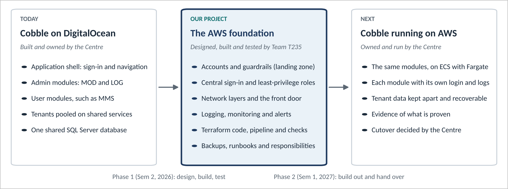

# Project definition

**P608: Cobbled AWS Platform Configuration** · Industry partner: Cyber
Security Centre (Wayne) · Team T235, QUT IFB398 Phase 1, Semester 2 2026

## Context

Cobble is the Cyber Security Centre's proof-of-concept platform for hosting
software modules for many customer organisations (tenants) at once. Its
modules are being built elsewhere, and its development environment runs on
DigitalOcean today. To move to AWS it needs the engineering underneath it:
accounts, network, sign-in, logging, monitoring, backups and security
controls.

The brief's reasoning: platforms fail less often because the idea is poor
than because the engineering foundation is weak.

*Where the project sits. Cobble's code stays with the Centre. Our work is the middle box: a tested AWS foundation that the Centre will own and run after Phase 2.*

## The problem this project solves

> Build an AWS engineering and security foundation for the Cobble
> Platform, test it, and propose to the Centre what it's ready for: holding
> tenant data, or a first Cobble module being built on it.

The project works in three steps: **build** the platform from code, **test**
it in AWS, then **propose** what's ready and what has to happen first. No
real tenant data and no Cobble modules are involved.

## Stakeholders

| Who | Interest | How we engage |
|---|---|---|
| Cyber Security Centre (Wayne) | An implementable foundation, with the issues, options and timeframes written down | Zoom client meetings, agreed at least fortnightly from Week 9; two held in Phase 1 ([minutes](phase-1-meetings.md)) |
| Tenants (Cobble's customer organisations) | Their data kept separate, safe and available | Represented by the threat model's multi-tenancy threats and the tenant-isolation risk (T1) |
| The Phase 2 team, or whoever builds Cobble next | Code and documents they can pick up without us | The [engineering handbook](../handbook/README.md), the runbooks and the [decision records](../decisions/README.md) |
| QUT teaching team | Evidence of the unit's learning outcomes | Tutor meetings; the sprint record and minutes in this repository |
| Team T235 | A meaningful capstone; cloud and security engineering skills | [Way of working](way-of-working.md) |

## Objectives

1. **A reference architecture and landing zone** that separate environments
   and duties, following the Centre's Implementation Guide.
2. **Security controls** across all ten areas the brief lists, built into
   code rather than only described.
3. **A working infrastructure-as-code prototype** that deploys, tears down
   and redeploys identically.
4. **An operations model**: deploy, monitor, patch, back up and support.
5. **An honest view of risk**: a threat model, a
   [risk register with governance and ethics](governance-risks-ethics.md),
   the remaining gaps, and how
   the design lines up with recognised frameworks.
6. **A proposal**: what the tests show the platform is ready for, and the
   options and plan for Phase 2.

## Scope

| In scope | Out of scope |
|---|---|
| AWS accounts, organisation and guardrails | The Cobble application and its modules (a stock nginx container stands in) |
| Network, compute, database and storage for each environment | Moving Cobble off DigitalOcean (it stays there until the Centre is ready) |
| Sign-in, logging, monitoring, backup and security services | Tenant sign-in and tenant isolation inside the application |
| Terraform for all of it, with tests, scanning and drift checks | Billing each tenant for its storage (raised by Wayne; after Phase 2) |
| Runbooks, threat model, compliance mapping, presentation | Real tenant data, and running the platform in production |

## Requirements

| # | Requirement | Source | Where it's met |
|---|---|---|---|
| R1 | Eight deliverables, from reference architecture to stakeholder presentation | Brief | [Deliverables](../README.md) |
| R2 | Two solutions: a full solution and a minimum viable product | Unit | [ADR 0003](../decisions/0003-two-solutions-mvp-and-full-landing-zone.md) |
| R3 | Recommendations that can actually be implemented | Wayne, 14 Sep | Both solutions built and deployed from code ([evidence](../deliverables/evidence.md)) |
| R4 | Issues and their solutions written down | Wayne, 14 Sep | [Scan findings](../deliverables/security-controls.md#scan-findings-register), the gaps table in each deliverable, the [evidence log](../deliverables/evidence.md#evidence-log) |
| R5 | 1 month and 3 month implementation options | Wayne, 14 Sep | [Phase 2 plan](phase-2-plan.md#implementation-options-1-month-or-3-months) |
| R6 | A schedule covering this semester and next | Wayne, 14 Sep | [Phase 1 sprint record](phase-1-sprints.md), [Phase 2 plan](phase-2-plan.md#schedule) |
| R7 | A web firewall in front of the platform | Wayne, 14 Sep | [ADR 0008](../decisions/0008-load-balancer-and-waf.md) |
| R8 | Single sign-on and no routine IAM users or long-lived keys | Implementation Guide §3.2 | IAM Identity Center; GitHub signs in through OIDC |
| R9 | Environments separated into their own accounts | Brief; Guide §3 | [Landing zone design](../deliverables/landing-zone-design.md) |
| R10 | The Guide's required tags on every resource | Guide | Provider `default_tags` in every root config |
| R11 | Close to A$0 when not being demonstrated | Team (personal AWS account) | Deploy around demos, then tear down ([ADR 0010](../decisions/0010-keep-accounts-between-demos.md)) |

## Success measures

| Measure | Phase 1 result |
|---|---|
| Deploys from code, tears down and redeploys identically | Solution A's landing zone and dev: four full cycles on 18 and 19 Oct 2026. Solution B: 48 resources |
| No drift after a redeploy | Re-running `up` while up reports 0 changes |
| Every change checked before merge | Format, validate, mocked tests and a Trivy scan in CI. A nightly drift check is built, but no environment is enrolled yet |
| Cost | About A$0.35 an hour while the demo is up, nothing after teardown; about A$790 a month with everything running |
| A proposal backed by the tests | The tests point to three High risks (T1, T2, T9) to close before tenant data or a first module; the options and plan are in the [Phase 2 plan](phase-2-plan.md) |
