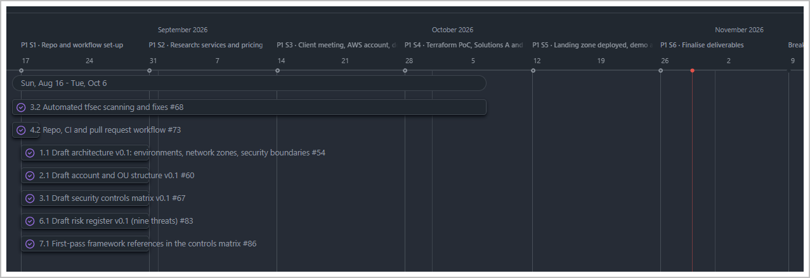
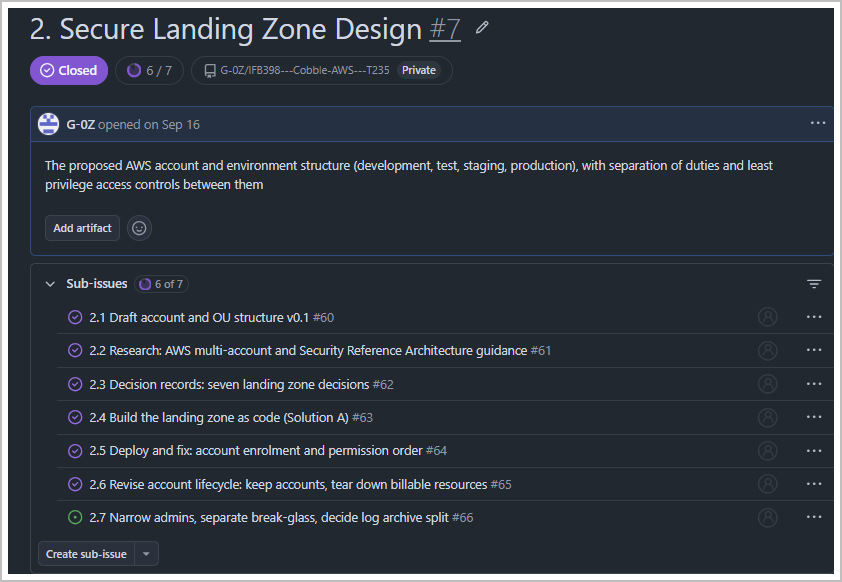

# Phase 1 sprint record (IFB398, Semester 2 2026)

Phase 1 ran as six two-week sprints, from Week 5 of QUT's Semester 2 2026
to the end of the study and exam period.
Each sprint followed the Scrum pattern:

| Event | When | Where |
|---|---|---|
| **Sprint planning** | First team meeting of the sprint (Wednesday, week 1 of the sprint) | Discord |
| **Sprint backlog** | Items pulled onto the board with an owner, priority, size and dates | GitHub project "Team Planning" |
| **Weekly sync** | Every Wednesday team meeting | Discord |
| **Sprint review** | Last team meeting of the sprint: what was finished, shown against the goal | Discord |
| **Retrospective** | Not held as a separate meeting; the review covered it | |

Roles: Max ran the sprints and the board (Scrum master), Wayne set
priorities and gave feedback for the Centre (acting product owner), and all
four members built and wrote the deliverables (the development team).

Each record below gives the **sprint goal**, **planning**, the **sprint
backlog** (tracker items), the **increment** (what was finished, with the
repository changes behind it), the **sprint review**, and **what we changed**, which stands in for the
retrospective. The meetings behind each sprint are in the
[Phase 1 meetings](phase-1-meetings.md), grouped the same way. Phase 2's
five sprints and two decision points are in the
[Phase 2 plan](phase-2-plan.md#schedule).

## How the work was tracked

Work lived on the GitHub project **Team Planning** from the first week.
The team considered user stories with MoSCoW priorities, but they didn't
fit deliverables that are designs, code and controls. Instead:

- each deliverable is a parent issue
- each requirement or client request is a sub-issue, with a task statement,
  owner, priority, size, sprint and dates

That way, every sprint review was about finished work.

*Phase 1 on the board. The six two-week sprints run across the top, from
repository set-up in Week 5 to finalising deliverables after Week 13.
Each bar is a numbered sub-issue of a deliverable.*

*How one deliverable was broken down. Deliverable 2 is a parent issue with
seven sub-issues: from the first draft of the account structure (2.1),
through building and deploying it (2.4, 2.5), to the lessons that followed
(2.6, 2.7). Six were closed during the study period.*

## The six sprints

| Sprint | QUT weeks | Goal | Result |
|---|---|---|---|
| [1](#sprint-1-repository-and-workflow) | 5–6 | Repository and workflow set up | Repository, CI and pull request workflow live; first client meeting |
| [2](#sprint-2-research-services-and-pricing) | 7–8 | Research: services and pricing | ECS vs EKS and pricing comparisons; architecture diagram for the client |
| [3](#sprint-3-client-meeting-aws-account-deliverables-scoped) | 9 and mid-semester break | Client meeting, AWS account, deliverables scoped | Wayne's five requests; deliverables on the tracker; own AWS organisation |
| [4](#sprint-4-terraform-proof-of-concept-solutions-a-and-b) | 10–11 | Terraform proof of concept, Solutions A and B | Solution B deployed (43 resources); Solution A validated with 71 tests |
| [5](#sprint-5-landing-zone-deployed-demo-and-deck) | 12–13 | Landing zone deployed, demo and deck | Landing zone deployed and recorded; 14-minute deck; first Phase 2 draft on the tracker |
| [6](#sprint-6-finalise-deliverables) | Study and exam period | Finalise deliverables and the Phase 1 report | Current |

---

## Sprint 1: Repository and workflow

**Weeks 5–6**

**Sprint goal:** set up the repository and delivery workflow, so every later
change goes through a pull request and automated checks.

**Sprint planning:** none recorded; the team's first recorded meeting is the review.

**Increment (what was finished)**

* Repository created with a folder structure for the deliverables and a
  README (Week 4).
* CI workflow added: `terraform validate` and a tfsec scan on `main` and
  each member's dev branch (Week 4).
* Pull request workflow and branch ruleset tested, then the test files
  removed (Week 5, PRs #1 to #4).
* No tracker items carry this sprint; the repository history is the record.

**Sprint review:** [team meeting 1](phase-1-meetings.md#week-6-team-meeting-1),
Week 6. GitHub Free doesn't enforce branch protection on a private
repository. The options noted were a public repository (needing the
Centre's approval under the NDA), a paid plan, or a documented team
convention. The first [client meeting](phase-1-meetings.md#week-6-client-meeting-1)
followed the next day.

**What we changed (retrospective):** GitHub Free couldn't enforce branch protection on a private repository, so review became a team rule: every change goes through a pull request that another member approves. The repository later moved to GitHub Pro so a ruleset enforces it.

**Next sprint:** research AWS services and pricing.

---

## Sprint 2: Research: services and pricing

**Weeks 7–8**

**Sprint goal:** work out how to host Cobble on AWS and what it would cost, ready
to present to the Centre in Week 9.

**Sprint planning:** [team meeting 2](phase-1-meetings.md#week-7-team-meeting-2), Week 7.

**Increment (what was finished)**

* Actions from the first client meeting added to the backlog.
* Amazon ECS and EKS compared for running Cobble's containers
  ([ADR 0005](../decisions/0005-ecs-fargate-not-eks.md)).
* Pricing compared across the candidate AWS services.
* The architecture diagram updated for client review.
* A research sprint: no tracker items, and no repository changes.

**Sprint review:** [team meeting 3](phase-1-meetings.md#week-8-team-meeting-3),
Week 8. All three were ready, and were presented to Wayne at
[client meeting 2](phase-1-meetings.md#week-9-client-meeting-2) in Week 9.

**What we changed (retrospective):** Nothing recorded.

**Next sprint:** follow up the client meeting, secure an AWS account and scope the
deliverables.

---

## Sprint 3: Client meeting, AWS account, deliverables scoped

**Week 9 and the mid-semester break**

**Sprint goal:** turn the second client meeting into a scoped plan, and secure an
AWS account for the proof of concept.

**Sprint planning:** [team meeting 4](phase-1-meetings.md#week-9-team-meeting-4), Week 9, after [client meeting 2](phase-1-meetings.md#week-9-client-meeting-2).

**Sprint backlog (tracker items)**

| Issue | Item | Owner | Status | Start to target |
|---|---|---|---|---|
| #5 | Update Intro to Tut doc | Max Gosling, Timothy Hartmann | Done | Weeks 5–9 |

**Increment (what was finished)**

* [Client meeting 2](phase-1-meetings.md#week-9-client-meeting-2) (Week 9):
  Wayne asked for implementable recommendations, documented issues and
  solutions, 1 month and 3 month options, and a two-semester schedule. The
  diagram needed a web firewall.
* Deliverables 1 to 8 added to the tracker as issues #6 to #13, each with an
  owner (Week 9).
* AWS Educate only offers training labs, so a personal AWS account with AWS
  Organizations was set up for the proof of concept
  ([ADR 0012](../decisions/0012-own-aws-organization.md)).
* The unit requires two solutions, so the work was split into Solution A
  (full landing zone) and Solution B (minimum viable product).
* Cost and technology selection report drafted, as a companion to the
  Engineering Implementation Guide v1.0.

**Sprint review:** [team meeting 5](phase-1-meetings.md#mid-semester-break-team-meeting-5),
during the mid-semester break.

**What we changed (retrospective):** The Week 9 tutor feedback said a working proof of concept was required, not only a report. That moved the team from describing the design to building it, which became Sprint 4's goal.

**Next sprint:** build the Terraform proof of concept and both solutions.

---

## Sprint 4: Terraform proof of concept, Solutions A and B

**Weeks 10–11**

**Sprint goal:** turn the design into working Terraform.

**Sprint planning:** [team meeting 6](phase-1-meetings.md#week-10-team-meeting-6), Week 10.

**Sprint backlog (tracker items)**

| Issue | Item | Owner | Status | Start to target |
|---|---|---|---|---|
| #23 | Medium Fidelity / Framework | Jacob Hardcastle | Done | Week 11 |

**Increment (what was finished)**

* Landing zone proof of concept added in Terraform, with test suites for five
  modules; repository folders aligned with the deliverables (Week 10, PRs #15
  to #19).
* tfsec findings fixed (VPC flow logs, S3 access logging, CloudTrail to
  CloudWatch), and state locking moved to S3's native lock file (Week 10).
* Solution A and Solution B added from one set of modules, with root
  configurations, modules and runbooks (Week 11, PR #21;
  [ADR 0003](../decisions/0003-two-solutions-mvp-and-full-landing-zone.md)).
* Solution A vs B comparison written, recommending Solution B now and
  Solution A as the target, with 1 month and 3 month options (Week 11).
* Deployment document refactored (Khai). Security review findings closed,
  Solution A checked in CI, naming conventions guide added (Week 11, PR #31).

**Sprint review:** [team meeting 7](phase-1-meetings.md#week-11-team-meeting-7),
Week 11. Solution B deployed and tested (43 resources); Solution A validated
with 71 automated tests and 0 open tfsec findings. Known gaps recorded:
Solution B's interim IAM users and shared admin group, and four Solution A
items for Phase 2.

**What we changed (retrospective):** During the sprint, keeping two code bases in step failed, so the code was restructured into one set of shared modules for both solutions ([ADR 0003](../decisions/0003-two-solutions-mvp-and-full-landing-zone.md)). The manual review found five problems the scanners had passed, so every role is now something to test, not just to write.

**Next sprint:** deploy the landing zone, run a demo and build the presentation
deck.

---

## Sprint 5: Landing zone deployed, demo and deck

**Weeks 12–13**

**Sprint goal:** deploy the landing zone in a live demo, capture the evidence and
build the stakeholder presentation.

**Sprint planning:** [team meeting 8](phase-1-meetings.md#week-12-team-meeting-8), Week 12.

**Sprint backlog (tracker items)**

| Issue | Item | Owner | Status | Start to target |
|---|---|---|---|---|
| #6 | 1. Target Architecture Diagram | Max Gosling | Done | Weeks 9–13 |
| #7 | 2. Secure Landing Zone Design | Khai Do | Done | Weeks 9–13 |
| #20 | 4.1 Review .md files and tie together | Max Gosling | Done | Weeks 9–13 |
| #24 | High Fidelity / Framework | Jacob Hardcastle | Done | Weeks 11–12 |
| #28 | Risk management documentation | Timothy Hartmann | Done | Weeks 11–13 |
| #32 | Clean-up PoC to meet SOCI compliance | Max Gosling | Done | Weeks 12–13 |
| #13 | 8. Final Stakeholder Presentation | All four members | In progress | Weeks 11–13 |

**Increment (what was finished)**

* Repository restructured so both solutions deploy and redeploy cleanly;
  prices shown in AUD (Week 12, PR #34;
  [ADR 0004](../decisions/0004-one-workload-per-environment.md)).
* Landing zone deployed in a dev demo; deploy issues fixed, with evidence
  and a runbook (Week 12, PR #35).
* The landing zone keeps its accounts between demos, with checks at every
  step; the second full run saved as the Solution A demo (Week 12, PR #36;
  [ADR 0010](../decisions/0010-keep-accounts-between-demos.md)).
* Stakeholder presentation built (Week 12), matched to the demo run and cut
  to 14 minutes with a script (Week 13, PRs #37 and #38).
* Threat model, risk assessment and risk management documentation
  completed by Tim (Week 13, PR #49).
* Deliverable issues #6 to #12 closed on the tracker (Week 13).

**Sprint review:** [team meeting 9](phase-1-meetings.md#week-13-team-meeting-9),
Week 13. A first draft of the Phase 2 plan was added to the tracker as P2.0 to P2.9
(#39 to #52); the milestone plan in the [Phase 2 plan](phase-2-plan.md) has
since replaced it. The team decided the report presents SQL Server as Cobble's database,
with the prototype's PostgreSQL swapped later; it's now stretch work once
the Centre chooses a licence
([ADR 0007](../decisions/0007-postgresql-now-sql-server-target.md)).

**What we changed (retrospective):** Closed accounts counted against the organisation's limit, so the code and teardown runbook now keep accounts and remove only what costs money ([ADR 0010](../decisions/0010-keep-accounts-between-demos.md)). The build depended on one person, so in Sprint 6 every teammate runs the deploy and teardown runbooks.

**Next sprint:** finalise the deliverables and the Phase 1 report.

---

## Sprint 6: Finalise deliverables

**Study and exam period**

**Sprint goal:** finalise the deliverables and the Phase 1 report. This is the last
Phase 1 sprint, and it is under way.

**Sprint planning:** none recorded yet.

**Sprint backlog (tracker items)**

| Issue | Item | Owner | Status | Start to target |
|---|---|---|---|---|
| #9 | 4. Infrastructure-as-Code Prototype | Max Gosling | Done | Week 9 to study period |
| #11 | 6. Threat Model and Risk Assessment | Timothy Hartmann | Done | Week 9 to study period |
| #8 | 3. Security Control Design | Khai Do | Done | Week 9 to study period |
| #10 | 5. Deployment and Operations Model | Max Gosling | Done | Week 9 to study period |
| #12 | 7. Compliance and Assurance Mapping | Unassigned | Done | Week 9 to study period |

**Increment so far:** the five deliverable items targeted for this sprint were
closed early, in Week 13.

**Still in the sprint backlog**

* A final review of those five deliverables against their targets.
* Finish the final stakeholder presentation (#13), and merge Jacob's open
  pull request (#53).
* Open repository issues not yet on the board: data pipeline blueprint
  (#25), user guidance documentation (#27), and user stories and MoSCoW
  hierarchy (#26). The team decided not to write user stories, and
  prioritises work on the board as P0 to P2 instead.
* Finalise the Phase 1 report.

---

*Source: GitHub project "Team Planning" (Sprint field, items, start and
target dates) and the repository history, read in Week 13. Weeks are QUT
Semester 2 2026 teaching weeks.*
