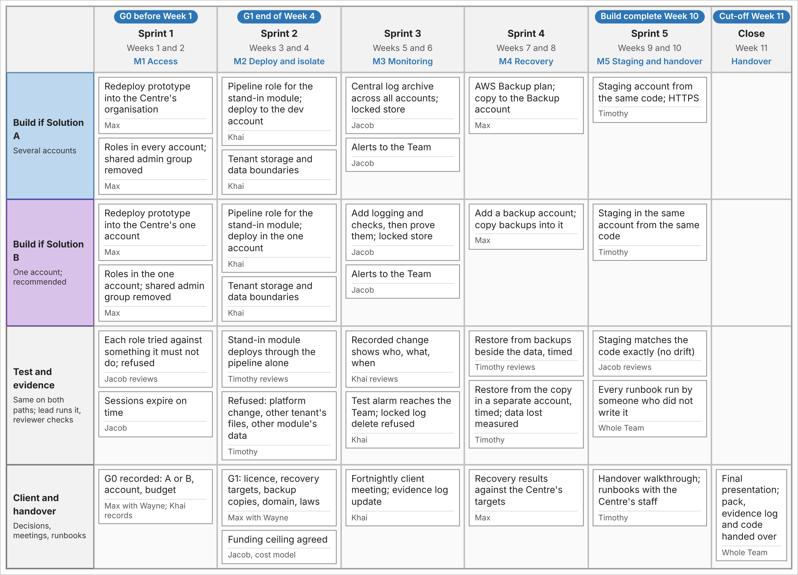

# Phase 2 plan (IFB399, Semester 1 2027)

**Phase goal:** move the platform from our proof-of-concept account into the
Cyber Security Centre's own AWS environment, and prove it there. We'll prove
sign-in, data separation, alerts and recovery with a **stand-in module**, a
simple web application that stands in for Cobble's code. Then we hand over a
tested platform and a proposal for what it's ready for next.

Because the platform is code, the move is a redeployment, not a rebuild: the
Terraform that built the prototype in 13 minutes builds it again in the
Centre's account. Moving one of Cobble's real modules is stretch work,
attempted only if the Centre supplies its software by Week 4. Live users,
real tenant data, Cobble's code, legal advice and certification are out of
scope.

*Each sprint delivers one milestone. The Test and evidence lane holds its
definition of done: the test that must pass before the work counts as
finished. The two Build lanes show the only work that differs between
Solution A and Solution B. G0 and G1 are the Centre's decision points.*

## Decision points

| Point | When | The Centre decides |
|---|---|---|
| **G0** | Before Week 1 | Solution A or B, and the AWS account and budget to build in |
| **G1** | End of Week 4 | Database licence, recovery targets, where backup copies go, the domain name, and which laws apply (Privacy Act, critical infrastructure) |

We recommend **Solution B**: build it now, prove each control on it, and grow
it towards Solution A one milestone at a time. The Centre can then stop at
any point with a working platform, and pay only for what it uses. The choice
is theirs, at G0. See [Solution A or B](#solution-a-or-b) below.

## Schedule

Weeks are QUT Semester 1 2027 teaching weeks
([academic calendar](https://www.qut.edu.au/about/key-dates-and-academic-calendar/academic-calendar/2027-academic-calendar)).
Sprints are two weeks and pause for the Easter break, which falls between
Weeks 5 and 6.

| Sprint | Weeks | Milestone | Lead | Reviewer |
|---|---|---|---|---|
| 1 | 1–2 | **M1 Access** | Max | Jacob |
| 2 | 3–4 | **M2 Deploy and isolate** | Khai | Timothy |
| 3 | 5–6 (Easter between) | **M3 Monitoring** | Jacob | Khai |
| 4 | 7–8 | **M4 Recovery** | Max | Timothy |
| 5 | 9–10 | **M5 Staging and handover** | Timothy | Jacob |
| Close | 11 | Handover | Whole team | |

Build work ends in Week 10, and the handover is complete by Week 11. The
order follows the requirements:
1. **Access** comes first, because a stolen administrator session is the
   threat that endangers every later test.
2. **Deployment and tenant boundaries** come next.
3. **Monitoring** is proven on the deployment M2 leaves running.
4. **Recovery** needs the targets the Centre sets at G1.
5. **A second environment** comes last, because a platform that can't be
   restored shouldn't be copied.

## How each sprint runs

Each two-week sprint is a Scrum sprint with one milestone as its goal.

| Event | When | What happens |
|---|---|---|
| **Sprint planning** | Wednesday, first week of the sprint (Discord) | The milestone is the sprint goal. Its build and test items go into the sprint backlog on the board, each with an owner, size and dates |
| **Weekly sync** | Wednesday, second week (Discord) | Progress against the goal, blockers, re-plan |
| **Sprint review** | End of the sprint | The milestone's test is run and shown; the evidence goes in the evidence log. With the Centre where a decision point falls (G1, end of Week 4) |
| **Retrospective** | Straight after the review | One thing to keep and one to change, recorded in the sprint record |

| Role | Who |
|---|---|
| Product owner | Wayne, for the Centre: decides at G0 and G1, and accepts the handover |
| Scrum master | Max: runs the sprints, the board and the decision points |
| Development team | All four. Each milestone has a lead and a reviewer (see the schedule above) |

Work counts as done only when the milestone's **definition of done** (below)
passes, and the rule in [What every sprint must show](#what-every-sprint-must-show)
holds.

## Milestones and their definitions of done

| Milestone | Build | Test and evidence (definition of done) |
|---|---|---|
| **M1 Access** | Redeploy the prototype into the Centre's account(s). Roles in every account; the shared admin group from Phase 1 removed | Each role tried against something it must not do, and refused. Sessions expire on time |
| **M2 Deploy and isolate** | A pipeline role for the stand-in module; deploy it to dev. Tenant storage and data boundaries | The stand-in module deploys through the pipeline alone. Refused: a platform change, another tenant's files, another module's data |
| **M3 Monitoring** | Logs and checks across the account(s), into a locked store. Alerts to the team | A recorded change shows who, what and when. A test alarm reaches the team, and deleting a locked log is refused |
| **M4 Recovery** | AWS Backup, with copies in a separate backup account | Restore from the backups beside the data, timed. Restore from the copy in the separate account, timed, with the data lost measured |
| **M5 Staging and handover** | A staging environment from the same code (with HTTPS on Solution A) | Staging matches the code exactly (no drift). Every runbook is run by someone who didn't write it |

What the tests won't prove: M2 shows that a module's role is refused
another tenant's storage and another module's data. Whether Cobble's own
code keeps tenants apart inside a shared database table can only be tested
with the Centre's developers. So threat T1 stays open until then.

## Solution A or B

The same code builds both. These are the only differences in the plan:

| | Solution A: several accounts | Solution B: one account (recommended) |
|---|---|---|
| M1 | Redeploy into the Centre's organisation; roles in every account | Redeploy into the Centre's one account; roles in that account |
| M2 | Deploy to the dev account | Deploy in the one account |
| M3 | Central log archive across all accounts | Add logging and checks, then prove them |
| M4 | Copies to the Backup account | Add a backup account, and copy backups into it |
| M5 | A staging account, with HTTPS | Staging in the same account |
| Cost | About A$544 a month run in a staged way; A$780 to A$797 with everything on | About A$7 a month if left running idle (A$0 when torn down); the Phase 2 tests add a database, monitoring and backups |

Costs are from the Week 13 cost model, with US prices converted at A$1.44.
They exclude database licences, tax and second-region backups.

## Implementation options: 1 month or 3 months

Wayne asked for both timeframes at client meeting 2 (Phase 1, Week 9). In this plan:

- **About 1 month (end of Week 4):** M1 and M2. The platform is in the
  Centre's account, every role is tested, and the stand-in module runs with
  its tenant boundaries proven.
- **About 3 months (Week 11):** all five milestones. Monitoring and alerts
  are proven, both restores are timed, staging exists, and the runbooks are
  handed over.

## Funding

The plan sets a **funding ceiling of A$100 a month**, which the Centre
agrees during Sprint 2, before M2 is finished (Jacob keeps the cost model). The estimated peak is about A$65 a month, in Weeks 7 to 10,
at AWS's Sydney prices. If the ceiling is refused, each test runs in a short
session that's torn down the same day. That still proves every milestone,
but drops the evidence that needs time.

## Risks to the plan

| Risk | What we'll do |
|---|---|
| The Centre's decision or account comes late | Ask for G0 before Semester 1. Until then, everything is ready to redeploy from code |
| Funding isn't agreed | Run each test in a same-day session, then tear it down |
| Cobble's software isn't supplied by Week 4 | Moving a real module stays stretch work; the stand-in module proves every milestone |
| Closed accounts count against the organisation's limit until about mid-January 2027, before Week 1 | Keep accounts between runs and remove only what costs money ([ADR 0010](../decisions/0010-keep-accounts-between-demos.md)) |
| The build depends on one person | Every teammate runs the runbooks, and each milestone has a lead and a reviewer |
| Cross-tenant isolation inside Cobble's code can't be tested without the Centre's developers | T1 stays open and is named in the proposal |

## What Phase 2 will produce

One tested result per milestone, rather than more documents:

- a role-test record (M1)
- deployment and isolation results (M2)
- monitoring evidence (M3)
- two restore reports (M4)
- a runbook handover record (M5)

Then, in Week 11, the final report, the presentation and the handover pack,
with a **migration plan marked as verified or unverified**. That is the
proposal to the Centre: what the tests show the platform is ready for
(holding tenant data, or a first Cobble module) and what still has to happen
first.

## What every sprint must show

The same rule as Phase 1: a change is done only when it has been deployed,
torn down and redeployed from code, a final plan shows no differences, and
the run logs are saved as evidence.

*Source: the Phase 1 report (Part One, "Going into Phase 2", and Figure 4).*
