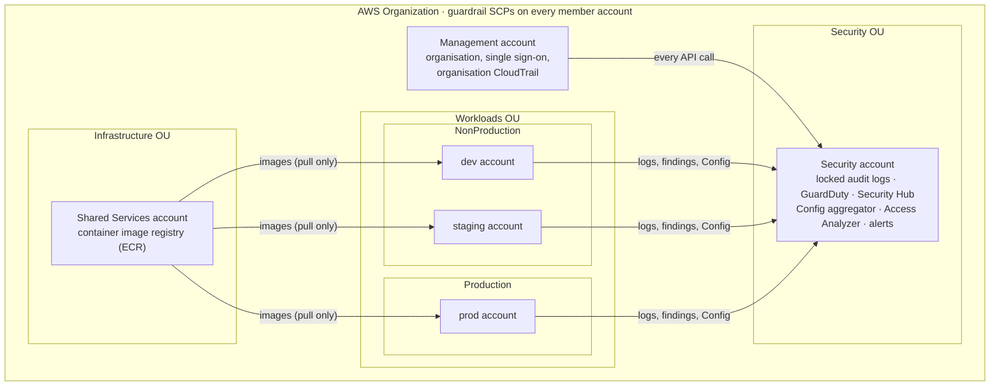
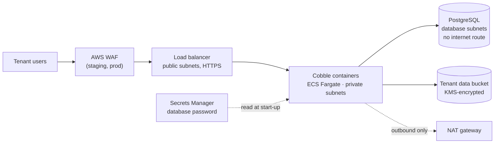

# Solution A: the full landing zone

The complete production design for Cobble: six AWS accounts in an AWS
Organization, with guardrails, single sign-on, central audit logs, threat
detection and three isolated environments. Each numbered folder is one
Terraform root config. Run them in order; each step uses outputs from the
one before.

**Step-by-step instructions:** [runbooks/deploy-solution-a.md](../../runbooks/deploy-solution-a.md)
**Why it's designed this way:** [ADR 0003](../../docs/02-landing-zone-design/adr/0003-two-solutions-mvp-and-full-landing-zone.md)

## The accounts

## Inside one environment

This matches the high-fidelity architecture diagram (prod uses
`10.30.0.0/16` and the same subnet ranges).

## The steps

| Step | Runs in | What it creates | Main outputs used later |
|---|---|---|---|
| 0. [`../bootstrap`](../bootstrap/) | Management account | Terraform state bucket | bucket name, for every `backend.hcl` |
| 1. [`1-organization`](1-organization/) | Management account | Organisation and OUs, 5 member accounts, 4 guardrail SCPs, Identity Center groups and permission sets, security delegation | `account_ids`, `organization_id` |
| 2. [`2-security`](2-security/) | Security account (+ management for the trail) | Locked audit-log bucket, organisation CloudTrail, GuardDuty, Security Hub (CIS + FSBP), Config aggregator, Access Analyzer, email alerts | `config_bucket_name`, `config_kms_key_arn` |
| 3. [`3-shared-services`](3-shared-services/) | Shared Services account | Container registry, account baseline, budget | `container_registry_url` |
| 4. [`4-workloads/dev`](4-workloads/dev/), [`staging`](4-workloads/staging/), [`prod`](4-workloads/prod/) | Each environment's account | Network, app, database, data bucket, CI deploy roles, budget | `app_url`, CI role ARNs |

## Files you fill in

Each step has two example files. Copy them without `.example` and fill them
in before running:

| File | What goes in it |
|---|---|
| `backend.hcl.example` | Where the state is kept (the bootstrap bucket name) |
| `settings.auto.tfvars.example` | Account IDs, email addresses, outputs of earlier steps |

Neither file holds secrets, so the filled-in versions can be committed, as
Solution B's `poc.auto.tfvars` is.

## What you do by hand

A few things have no AWS API, so Terraform can't do them. The runbook lists
when:

1. Enable IAM Identity Center for the organisation, and require MFA.
2. Add people to the Identity Center groups.
3. Confirm the security alert email subscription.
4. Create the GitHub environments (`dev`, `staging`, `prod`) with required
   reviewers.
5. Request an ACM certificate once a domain (e.g. `dev.cobble.com`) is ready.
