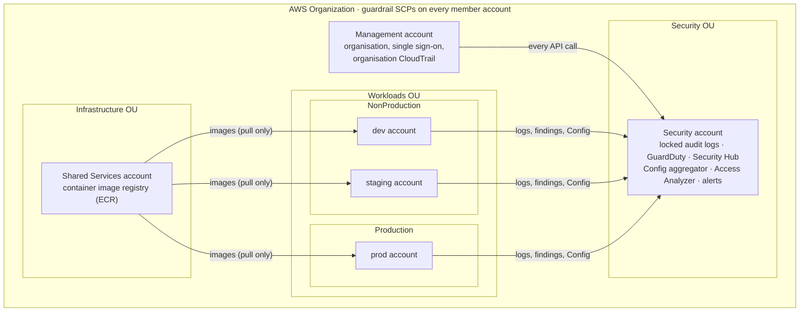
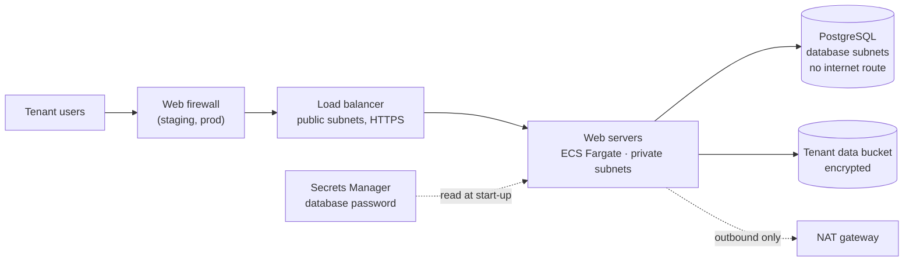

# Solution A: the full landing zone

The complete design we'd recommend for running Cobble in production: six AWS
accounts with guardrails, single sign-on, locked audit logs, central threat
detection, and separate dev, staging and prod environments.

It comes in two parts, and you don't need the whole thing to see it working:

| Part | What it is | How to see it |
|---|---|---|
| [`workload/`](workload/) | One Cobble environment: the network, web servers, database and data bucket. The same code builds every environment; only the settings file differs (`demo`, `dev`, `staging` or `prod.tfvars`) | **Demo:** deploy it into the team's account for a few hours (about US$0.15 an hour), then tear it down. [runbooks/demo-solution-a.md](../../runbooks/demo-solution-a.md) |
| [`landing-zone/`](landing-zone/) | The organisation around the environments: people, accounts and guardrails, central security, the container registry. Set up once and left running | [runbooks/deploy-solution-a.md](../../runbooks/deploy-solution-a.md) |

Why it's designed this way is explained in
[deliverable 2's key decisions](../../docs/02-landing-zone-design/README.md#key-decisions).

## The accounts

## Inside one environment

Only the load balancer faces the internet. The web servers can be reached
only through it, and the database only from the web servers. This matches
the team's architecture diagram (prod uses `10.30.0.0/16`).

## Building the whole thing

The full build runs in this order. Each step hands values to the next.

| Step | Folder | Runs in | Builds | Hands on |
|---|---|---|---|---|
| 0 | [`../bootstrap`](../bootstrap/) | Management account | The bucket for Terraform's records (shared with Solution B) | |
| People | [`landing-zone/identity`](landing-zone/identity/) | The account that runs Identity Center | Groups, and a login for each person in `users.csv` | |
| 1 | [`landing-zone/1-organization`](landing-zone/1-organization/) | Management account | Account folders, 5 member accounts, 4 guardrails, each group's access | `account_ids`, `organization_id` |
| 2 | [`landing-zone/2-security`](landing-zone/2-security/) | Security account | Locked audit logs, audit trail, threat detection, security checks, email alerts | `config_bucket_name`, `config_kms_key_arn` |
| 3 | [`landing-zone/3-shared-services`](landing-zone/3-shared-services/) | Shared Services account | Container registry | `container_registry_url` |
| 4 | [`workload`](workload/) with `dev`, `staging`, `prod.tfvars` | Each environment's account | Network, web servers, database, data bucket, GitHub roles, budget | `app_url` |

## Files you fill in

- **Landing zone:** each step has a `settings.auto.tfvars.example`. Copy it to `settings.auto.tfvars` and fill it in (account IDs, emails, values from earlier steps). The filled-in copies stay off GitHub, because they hold real email addresses.
- **Workload:** the settings files are committed. `demo.tfvars` is ready to use. In `dev`, `staging` and `prod.tfvars`, replace each `REPLACE:` value with the landing zone's outputs.
- **Terraform's records:** every folder already points at the shared bucket (in its `backend.tf`), so there's nothing to fill in.

## What you do by hand

A few things have no AWS API, so Terraform can't do them. The runbook says
when to do each:

1. Enable IAM Identity Center for the organisation, require MFA, and turn on
   "Send email OTP" so people created by Terraform can set their own password.
2. Confirm the security alert email subscription.
3. Create the GitHub environments (`dev`, `staging`, `prod`) with required
   reviewers.
4. Request an ACM certificate once a domain (e.g. `dev.cobble.com`) is ready.
