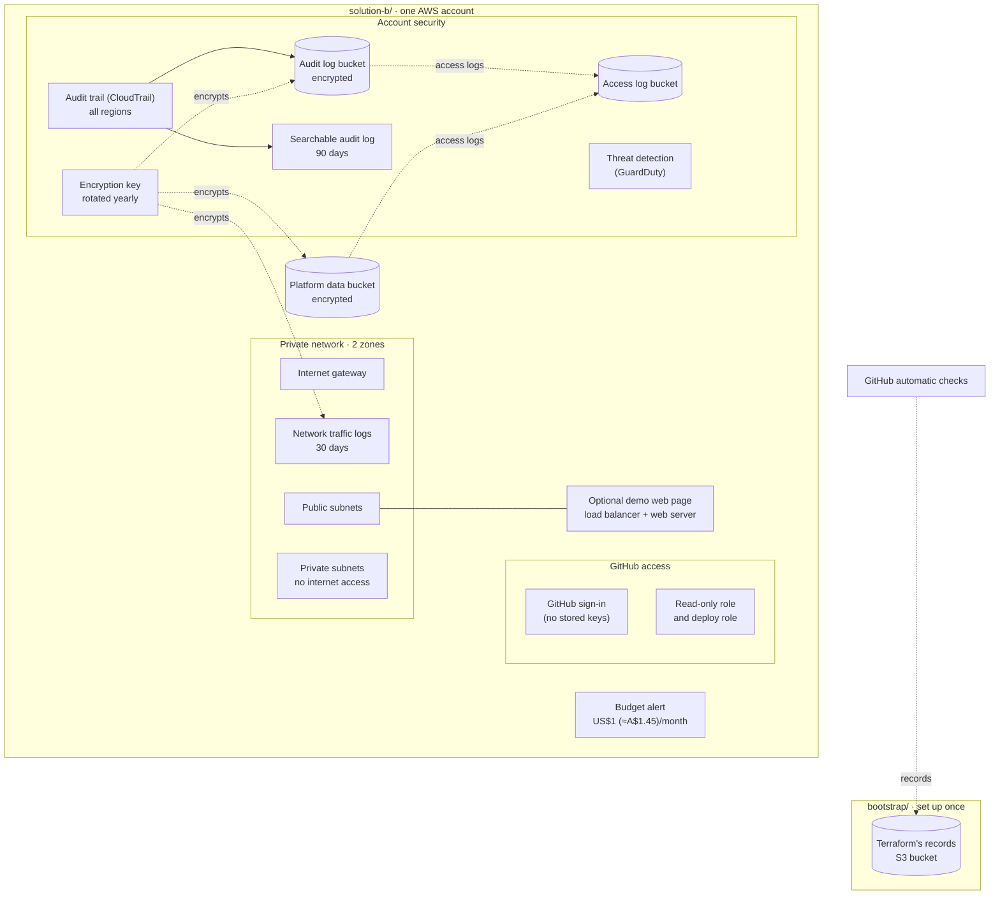

# Solution B: the minimum viable product

The smallest secure version of the Cobble platform, in one AWS account. One
command builds it (48 resources, about 5 minutes) and one command removes
it. It's also called **the MVP** or **the PoC**.

| | |
|---|---|
| **Builds** | An encryption key, an audit trail of every action (CloudTrail), threat detection (GuardDuty), a private network with traffic logging, an encrypted data bucket, GitHub's access roles, and a budget alert at US$1 (about A$1.45; AWS budgets only work in US dollars). Optionally, a demo web page |
| **Runs in** | The team's AWS account. Terraform refuses to run against any other account |
| **Settings** | [`poc.auto.tfvars`](poc.auto.tfvars): the only file to edit to change a setting. It holds no secrets, so it's committed |
| **Cost** | About A$0, because it's only deployed around demos. The demo web page adds about A$1.90 a day |
| **Deploy / tear down** | [runbooks/deploy.md](../../runbooks/deploy.md), [runbooks/teardown.md](../../runbooks/teardown.md) |

To see everything it builds, read [`main.tf`](main.tf) from top to bottom.

## What it looks like

Solid arrows show data and logs flowing. Dotted arrows show encryption,
records or trust. Cylinders are S3 buckets.

## Switches in `poc.auto.tfvars`

| Setting | What it does |
|---|---|
| `enable_demo_app` | `true` adds a load balancer and a small web server, so the MVP can show a web page. Leave it `false` except during demos |
| `enable_guardduty` | Set to `false` if Solution A's landing zone should own this account's threat detection (AWS allows one detector). The demo leaves it `true` and sets the landing zone's `enable_management_guardduty = false` instead |

## How it differs from Solution A

Solution B keeps cost near zero by simplifying. The
[root README](../../README.md#what-solution-b-leaves-out-and-how-solution-a-fills-the-gap)
lists each simplification and how Solution A handles it.

This folder was called `envs/poc` until October 2026. Its record in the
state bucket still has the old name (`poc/terraform.tfstate`), and that must
never change.
